<div align="center">

# Experiment 3 — Analyze Synchronization Mechanisms in Parallel Programs
### Race Condition · Critical Section · Atomic Operation · Lock · Barrier · Semaphore

**Course:** Parallel Computing and GPU Programming (PGC) Laboratory
**Libraries Used:** OpenMP (`critical`, `atomic`, `omp_lock_t`, `barrier`) · POSIX Threads + POSIX Semaphores
**Platform:** Ubuntu guest on VMware Workstation · GCC with `-fopenmp` / `-pthread`


-ea580c)

</div>

---

## Abstract

When several threads update the **same variable**, the result can be wrong unless the threads are **synchronized**. Synchronization keeps the result correct, but it also costs time. This experiment measures that trade-off.

Six C programs were written and run on an Ubuntu virtual machine. Five of them demonstrate one mechanism each: a **race condition** (no synchronization), a **critical section**, an **atomic operation**, a **barrier** and a **semaphore**. The sixth, `compare_sync.c`, times the same job (**10,000,000 increments of one shared counter**) with four strategies (**None, Critical, Atomic and Lock**) using **1, 2, 4 and 8 threads**.

**Results:**

- **Correctness:** without synchronization the counter was wrong as soon as two threads were used. The program **lost 34.3 %, 64.0 % and 76.7 %** of the updates at 2, 4 and 8 threads. Critical, Atomic, Lock and the semaphore were correct in **every** run (10,000,000 and 200,000), and the barrier kept all "before" lines ahead of all "after" lines.
- **Speed:** **Atomic was the fastest correct mechanism**: 0.0541 s with 1 thread and about **0.126 s** with 2–8 threads. Critical and Lock took **0.48–0.55 s** at 4–8 threads, **3.8–4.4× slower** than Atomic.
- **Scalability:** **no mechanism got faster with more threads.** Going from 1 to 8 threads made Atomic **2.3×**, Critical **5.3×** and Lock **6.2×** slower. When every iteration updates one shared variable, the threads can only take turns, so adding threads adds waiting.

---

## Table of Contents

1. [Introduction](#1-introduction)
2. [Aim and Objectives](#2-aim-and-objectives)
3. [Basic Concepts](#3-basic-concepts)
4. [Experimental Setup](#4-experimental-setup)
5. [Methodology and Learning Flow](#5-methodology-and-learning-flow)
6. [Environment Preparation](#6-environment-preparation)
7. [Part A — The Five Synchronization Programs](#7-part-a--the-five-synchronization-programs)
8. [Part B — Comparison Benchmark (compare_sync.c)](#8-part-b--comparison-benchmark-compare_syncc)
9. [Consolidated Results](#9-consolidated-results)
10. [Performance Analysis](#10-performance-analysis)
11. [Comparison of the Mechanisms](#11-comparison-of-the-mechanisms)
12. [Observations and Limitations](#12-observations-and-limitations)
13. [Troubleshooting and Issues Encountered](#13-troubleshooting-and-issues-encountered)
14. [Important Terms](#14-important-terms)
15. [Conclusion](#15-conclusion)
16. [Repository Structure and Reproduction](#16-repository-structure-and-reproduction)
17. [References](#17-references)

---

## 1. Introduction

In a **shared-memory** program, all threads can read and write the same variables. That makes sharing data easy, but it also creates a problem. Look at one line:

```c
counter++;
```

It looks like one step, but the CPU actually does **three**:

```text
1. READ   counter from memory into a register
2. ADD    1 to the register
3. WRITE  the register back to counter
```

If two threads do this at the same time, both can read the **same old value**, and one update is lost:

```text
counter = 10
Thread A -> READ 10
Thread B -> READ 10
Thread A -> WRITE 11
Thread B -> WRITE 11        <- should be 12: one update is LOST
```

This is a **race condition**. **Synchronization mechanisms** are the tools that prevent it. Each one makes the update safe in a different way and at a different cost:

| Mechanism | How it protects the shared data | Where it comes from |
|:--|:--|:--|
| **Critical section** | Only one thread at a time may run the protected block | `#pragma omp critical` (OpenMP) |
| **Atomic operation** | The CPU does read + add + write as **one indivisible instruction** | `#pragma omp atomic` (OpenMP) |
| **Lock** | A thread must acquire the lock before the update and release it after | `omp_lock_t` (OpenMP) |
| **Semaphore** | A counter: `sem_wait` takes a permit, `sem_post` gives it back | `<semaphore.h>` (POSIX) |
| **Barrier** | Does not protect data; makes all threads **wait for each other** at one point | `#pragma omp barrier` (OpenMP) |

Experiment 2 showed *that* races happen and that a mutex or `critical` fixes them. This experiment goes one step further: it **measures what each fix costs** and **how that cost changes with more threads**.

---

## 2. Aim and Objectives

**Aim:** To implement and study common synchronization mechanisms used in shared-memory parallel programs (an unsynchronized race update, critical sections, atomic operations, barriers, and semaphores/locks) and to evaluate their correctness, execution time and scalability as the number of threads increases.

**Objectives:**

1. Show a **race condition** on a shared counter and measure how many updates are lost.
2. Fix it with a **critical section**, an **atomic operation**, a **lock** and a **semaphore**, and confirm the result is always correct.
3. Use a **barrier** to keep the phases of a parallel program in order.
4. Measure the **execution time** of None, Critical, Atomic and Lock with **1, 2, 4 and 8 threads**.
5. Judge every mechanism on **correctness, performance and scalability**, and explain the differences.

---

## 3. Basic Concepts

### 3.1 The three questions asked of every mechanism

| Property | Question | How it is measured here |
|:--|:--|:--|
| **Correctness** | Is the answer always right, whatever the thread timing? | Final count = 10,000,000? |
| **Performance** | How fast is it for a given number of threads? | Time in seconds (`omp_get_wtime()`) |
| **Scalability** | Does it get faster (or at least not slower) with more threads? | Time with *p* threads ÷ time with 1 thread |

### 3.2 Directives and functions used

| Task | Code | Program |
|:--|:--|:--|
| Run a loop on many threads | `#pragma omp parallel for` | race, critical, atomic, compare_sync |
| One thread at a time in a block | `#pragma omp critical { ... }` | critical, compare_sync |
| Indivisible update of one variable | `#pragma omp atomic` | atomic, compare_sync |
| Explicit lock | `omp_init_lock`, `omp_set_lock`, `omp_unset_lock`, `omp_destroy_lock` | compare_sync |
| Wait for all threads | `#pragma omp barrier` | barrier |
| Semaphore | `sem_init`, `sem_wait`, `sem_post`, `sem_destroy` | semaphore |
| Choose the thread count | `omp_set_num_threads(n)` or `OMP_NUM_THREADS=n` | compare_sync |
| Wall-clock timer | `omp_get_wtime()` | compare_sync |

### 3.3 Formulas used in the analysis

| Metric | Formula | Meaning |
|:--|:--|:--|
| **Lost updates** | $\dfrac{10{,}000{,}000 - \text{final count}}{10{,}000{,}000} \times 100\%$ | Share of increments destroyed by the race |
| **Cost per increment** | $\dfrac{\text{time}}{10{,}000{,}000}$ (ns) | Average time for one protected `counter++` |
| **Scaling factor** | $\dfrac{T(p)}{T(1)}$ | Below 1 = faster with *p* threads; above 1 = slower |
| **Relative cost** | $\dfrac{T_{\text{Critical or Lock}}}{T_{\text{Atomic}}}$ | How many times slower than Atomic |

---

## 4. Experimental Setup

The values below come from the terminal screenshots. Items that were not shown are marked **Not captured**.

| Item | Details |
|:--|:--|
| Host | Windows PC with **VMware Workstation** |
| Guest | Ubuntu VM, user `master`, hostname **`master-VMware-Virtual-Platform`** |
| Ubuntu version | **Not captured** (the manual specifies Ubuntu 22.04 LTS) |
| Compiler | GCC from `build-essential`. Version **Not captured** (`gcc --version` not in the screenshots) |
| OpenMP check | `echo '#include <omp.h>' \| gcc -E -fopenmp -x c - …` → **OpenMP OK** |
| Logical CPUs | **Not captured** (`nproc` not run). The barrier program, run without a thread count, started **4 threads**, and OpenMP's default is one thread per logical CPU, so the VM most likely had **4 vCPUs** |
| Compile commands | `gcc <file>.c -fopenmp -o <file>`; `gcc semaphore.c -pthread -o semaphore` (no `-O` flag, as in the manual) |
| Workload | 10,000,000 increments of one shared counter (100,000 × 2 for the semaphore program) |
| Timer | `omp_get_wtime()` (wall-clock), around the whole parallel loop |
| Date | 22 October 2026, about 14:38–14:40 IST (screenshot times) |

---

## 5. Methodology and Learning Flow

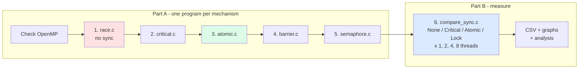

Every program followed the same cycle: `nano <file>.c` → `gcc ... -o <file>` → `./<file>`. The four screenshots were renamed in execution order (`01` … `04`) and saved in [`screenshots/`](screenshots). Every output was typed into [`results/raw/`](results/raw), and the measured table is in [`results/compare_sync_results.csv`](results/compare_sync_results.csv).

---

## 6. Environment Preparation

| Step | Command | Purpose | Result |
|:-:|:--|:--|:--|
| 1 | `sudo apt update && sudo apt install build-essential -y` | Install GCC, Make and the OpenMP runtime (`libgomp`) | Installed earlier (Not captured) |
| 2 | `echo '#include <omp.h>' \| gcc -E -fopenmp -x c - > /dev/null && echo "OpenMP OK"` | Check that GCC can find `omp.h` with `-fopenmp` | **OpenMP OK** |
| 3 | `nano <file>.c` | Create each program | 6 source files ([`src/`](src)) |
| 4 | `gcc <file>.c -fopenmp -o <file>` | Compile an OpenMP program | No errors or warnings |
| 5 | `gcc semaphore.c -pthread -o semaphore` | Compile the POSIX semaphore program | No errors or warnings |

The step-2 command works like this: `gcc -E` runs only the **preprocessor**, which is the stage that opens `#include` files. If `omp.h` were missing it would fail, and `&&` would skip the echo.

---

## 7. Part A — The Five Synchronization Programs

Programs 1–3 ran with OpenMP's **default thread count**. The barrier output shows this was **4 threads** on this VM.

### Program 1 — Race Condition (`race.c`)

```c
long counter = 0;
#pragma omp parallel for
for (long i = 0; i < 10000000; i++) counter++;     // no protection
printf("Counter=%ld\n", counter);
```

**Output:**

```text
Counter=3121112
```

**Expected 10,000,000 → got 3,121,112.** That is **6,878,888 updates lost (68.8 %)**. `counter` is shared by all threads, and their read-add-write steps overlapped, exactly as in the Introduction. The exact number changes on every run, because it depends on how the threads happen to be scheduled.

---

### Program 2 — Critical Section (`critical.c`)

```c
#pragma omp parallel for
for (long i = 0; i < 10000000; i++) {
    #pragma omp critical
    { counter++; }                                  // only ONE thread at a time
}
```

**Output:**

```text
Counter=10000000
```

✅ **Correct.** `#pragma omp critical` lets only one thread inside the block at a time. The others **wait in line**, so no read-add-write can overlap.

---

### Program 3 — Atomic Operation (`atomic.c`)

```c
#pragma omp parallel for
for (long i = 0; i < 10000000; i++) {
    #pragma omp atomic
    counter++;                                      // one indivisible CPU instruction
}
```

**Output:**

```text
Counter=10000000
```

✅ **Correct.** `#pragma omp atomic` tells the compiler to do the increment with a single **hardware atomic instruction** (on x86, an add with the `lock` prefix). The CPU guarantees that no other core can touch that memory location in the middle of it. No lock object or waiting queue is needed. It only works for simple updates such as `x++`, `x += v` or `x = x * v`, not for whole blocks of code.

---

### Program 4 — Barrier (`barrier.c`)

```c
#pragma omp parallel
{
    printf("Thread %d before barrier\n", omp_get_thread_num());
    #pragma omp barrier                             // wait here until ALL threads arrive
    printf("Thread %d after barrier\n", omp_get_thread_num());
}
```

**Output:**

```text
Thread 0 before barrier
Thread 1 before barrier
Thread 2 before barrier
Thread 3 before barrier
Thread 3 after barrier
Thread 1 after barrier
Thread 0 after barrier
Thread 2 after barrier
```

✅ **All 4 "before" lines appear before any "after" line.** The barrier is a meeting point: no thread may continue until every thread has reached it. The order *within* each phase is up to the scheduler: "after" came out as 3, 1, 0, 2. A barrier does not protect any variable; it keeps the **phases** of a computation in order. The output also shows the team had **4 threads (0–3)**.

---

### Program 5 — Semaphore (`semaphore.c`)

```c
sem_t semaphore;            // initialised to 1 -> a binary semaphore
int counter = 0;

void *work(void *a) {
    for (int i = 0; i < 100000; i++) {
        sem_wait(&semaphore);   // take the permit (wait if it is 0)
        counter++;
        sem_post(&semaphore);   // give it back
    }
    return NULL;
}
/* main: sem_init(&semaphore, 0, 1); 2 pthreads run work(); join; print; sem_destroy */
```

**Output:**

```text
Counter=200000
```

✅ **Correct:** 2 threads × 100,000 = **200,000**. A semaphore holds a number of permits. With an initial value of **1** it acts like a lock: `sem_wait` lowers it to 0, so the other thread must wait until `sem_post` raises it back to 1. With an initial value of *N*, up to *N* threads could be inside at once. This program was not timed.

### Part A Screenshot

<p align="center">
  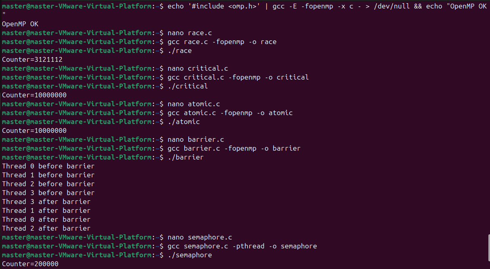<br>
  <em>Figure A.1 — OpenMP check, then race (3121112), critical (10000000), atomic (10000000), barrier (all "before" lines first) and semaphore (200000).</em>
</p>

---

## 8. Part B — Comparison Benchmark (`compare_sync.c`)

### 8.1 What the program does

Full source: [`src/compare_sync.c`](src/compare_sync.c). It contains four functions that do the **same work** (10,000,000 × `counter++`) in four ways:

```c
long run_none(int nthreads) {             // 1. no synchronization
    omp_set_num_threads(nthreads);
    #pragma omp parallel for
    for (long i = 0; i < N; i++) counter++;
}
long run_critical(...) { ... #pragma omp critical { counter++; } ... }   // 2.
long run_atomic(...)   { ... #pragma omp atomic   counter++;      ... }   // 3.
long run_lock(...) {                                                     // 4.
    ... omp_set_lock(&lock); counter++; omp_unset_lock(&lock); ...
}
```

`run_and_report()` times each function with `omp_get_wtime()`, compares the result with `N`, and prints one row. `main()` repeats all four for **1, 2, 4 and 8 threads** (16 runs in total).

### 8.2 Output

```text
Comparing synchronization mechanisms for 10000000 shared increments

Mechanism  | Threads |  Final Count | Correctness |   Time (s)
---------------------------------------------------------------
None       |       1 |     10000000 |    Correct |     0.0036
Critical   |       1 |     10000000 |    Correct |     0.0907
Atomic     |       1 |     10000000 |    Correct |     0.0541
Lock       |       1 |     10000000 |    Correct |     0.0895
---------------------------------------------------------------
None       |       2 |      6565726 |  INCORRECT |     0.0071
Critical   |       2 |     10000000 |    Correct |     0.2569
Atomic     |       2 |     10000000 |    Correct |     0.1252
Lock       |       2 |     10000000 |    Correct |     0.3254
---------------------------------------------------------------
None       |       4 |      3600942 |  INCORRECT |     0.0087
Critical   |       4 |     10000000 |    Correct |     0.4984
Atomic     |       4 |     10000000 |    Correct |     0.1268
Lock       |       4 |     10000000 |    Correct |     0.4927
---------------------------------------------------------------
None       |       8 |      2332535 |  INCORRECT |     0.0100
Critical   |       8 |     10000000 |    Correct |     0.4837
Atomic     |       8 |     10000000 |    Correct |     0.1260
Lock       |       8 |     10000000 |    Correct |     0.5510
---------------------------------------------------------------
```

### Part B Screenshots

| | |
|:-:|:-:|
| 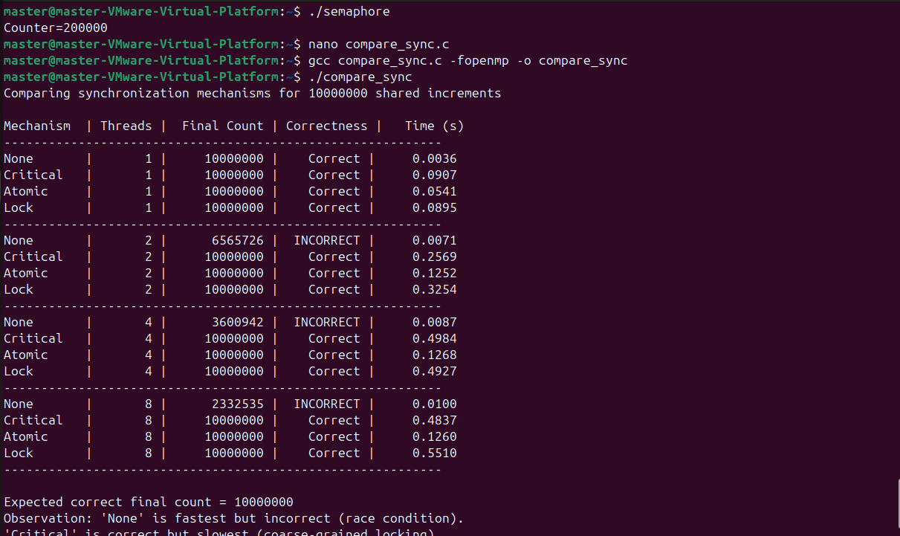<br><em>02 — <code>gcc compare_sync.c -fopenmp</code> and <code>./compare_sync</code></em> | 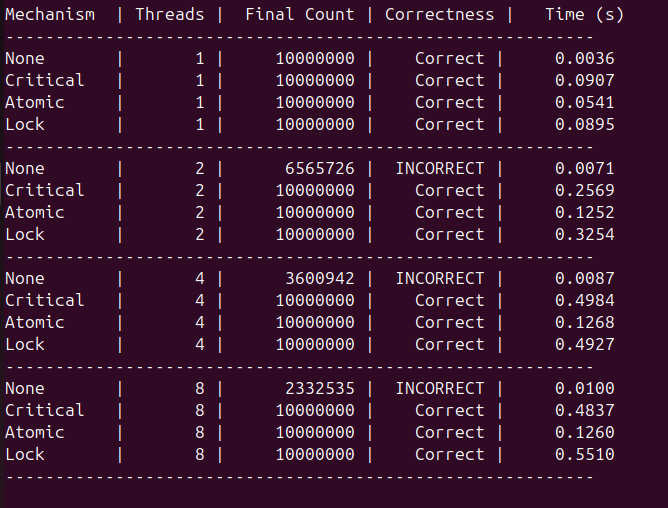<br><em>03 — the full results table (1, 2, 4, 8 threads)</em> |

<p align="center">
  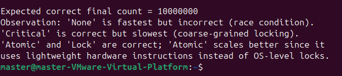<br>
  <em>04 — expected count and the program's printed observations.</em>
</p>

---

## 9. Consolidated Results

### 9.1 Part A — functional programs

| # | Program | Mechanism | Threads | Expected | Observed | Status |
|:-:|:--|:--|:-:|:--|:--|:-:|
| 1 | `race.c` | None | 4 (default) | 10,000,000 | **3,121,112** (68.8 % lost) | ⚠️ wrong (as intended) |
| 2 | `critical.c` | `omp critical` | 4 (default) | 10,000,000 | 10,000,000 | ✅ |
| 3 | `atomic.c` | `omp atomic` | 4 (default) | 10,000,000 | 10,000,000 | ✅ |
| 4 | `barrier.c` | `omp barrier` | 4 (default) | all "before" before any "after" | before 0,1,2,3 → after 3,1,0,2 | ✅ |
| 5 | `semaphore.c` | POSIX semaphore | 2 | 200,000 | 200,000 | ✅ |

### 9.2 Part B — execution time (seconds)

| Threads | None | Critical | Atomic | Lock |
|:-:|--:|--:|--:|--:|
| 1 | 0.0036 | 0.0907 | **0.0541** | 0.0895 |
| 2 | 0.0071 ❌ | 0.2569 | **0.1252** | 0.3254 |
| 4 | 0.0087 ❌ | 0.4984 | **0.1268** | 0.4927 |
| 8 | 0.0100 ❌ | 0.4837 | **0.1260** | 0.5510 |

❌ = wrong final count. Bold = fastest **correct** result in that row.

### 9.3 Derived metrics

| Threads | Updates lost by None | Atomic (ns/increment) | Critical (ns/increment) | Lock (ns/increment) | Critical ÷ Atomic | Lock ÷ Atomic |
|:-:|--:|--:|--:|--:|--:|--:|
| 1 | 0 % | 5.4 | 9.1 | 8.9 | 1.68× | 1.65× |
| 2 | **34.3 %** | 12.5 | 25.7 | 32.5 | 2.05× | 2.60× |
| 4 | **64.0 %** | 12.7 | 49.8 | 49.3 | 3.93× | 3.89× |
| 8 | **76.7 %** | 12.6 | 48.4 | 55.1 | 3.84× | 4.37× |

**Worked example (Lock, 8 threads):** cost per increment $= 0.5510 / 10^7 = 55.1$ ns; relative cost $= 0.5510 / 0.1260 = 4.37\times$ Atomic; scaling factor $= 0.5510 / 0.0895 = 6.16\times$ slower than with 1 thread.

Raw data: [`results/compare_sync_results.csv`](results/compare_sync_results.csv) · [`results/program_outputs.csv`](results/program_outputs.csv) · [`results/derived_metrics.csv`](results/derived_metrics.csv)

---

## 10. Performance Analysis

All graphs are generated with **matplotlib** by [`scripts/generate_graphs.py`](scripts/generate_graphs.py) from the CSV files in `results/`.

### 10.1 How each mechanism works

<p align="center">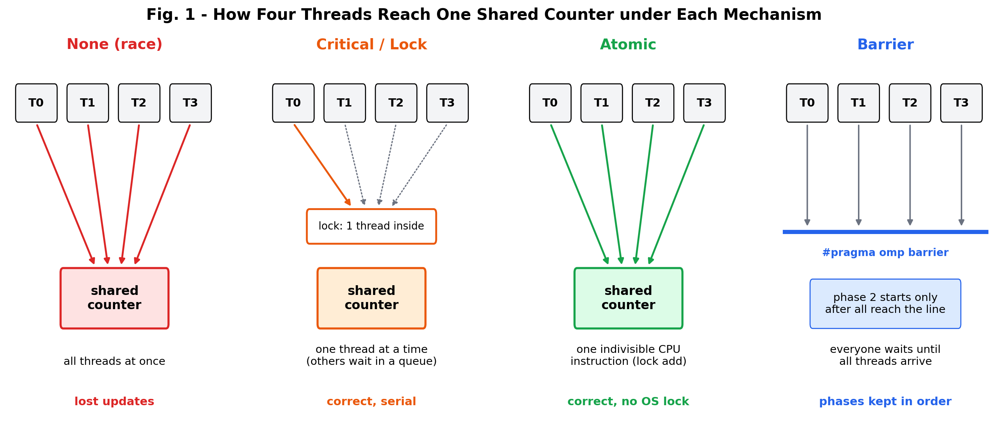</p>

**What the figure shows:** with **None**, all threads hit the counter at once and updates are lost. **Critical** and **Lock** let one thread in at a time while the others wait. **Atomic** lets every thread update directly, but each update is a single indivisible instruction. A **barrier** protects no data; it makes every thread wait at one line before the next phase.

### 10.2 Execution time vs threads

<p align="center">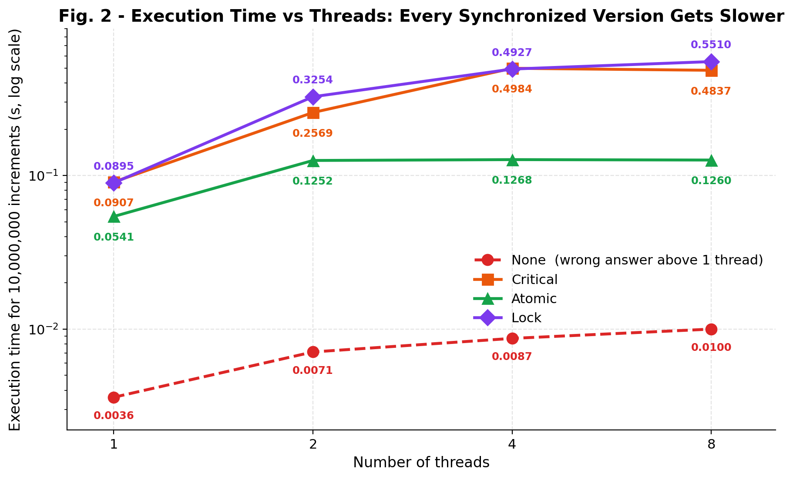</p>

**What the graph shows** (log scale):
- **None** is by far the fastest (3.6–10 ms), but above 1 thread its answer is **wrong**, so its speed is worthless.
- **Atomic** doubles from 1 to 2 threads (0.054 → 0.125 s) and then stays **flat** at about 0.126 s for 4 and 8 threads.
- **Critical** and **Lock** keep climbing to about **0.5 s** and are the slowest at every thread count above 1.
- **Every synchronized line goes up, not down.** More threads never made the shared counter faster.

### 10.3 Correctness and lost updates

<p align="center">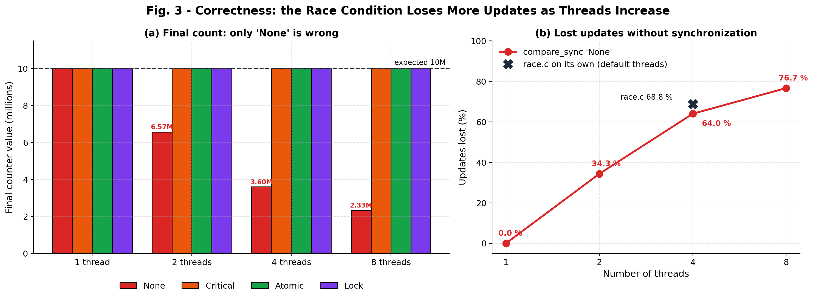</p>

**What the graph shows:**
- **(a)** Critical, Atomic and Lock reach exactly 10,000,000 at every thread count. Only **None** falls short: 6.57 M, 3.60 M and 2.33 M.
- **(b)** The share of lost updates **grows with the thread count**: 0 % → 34.3 % → 64.0 % → 76.7 %. More threads means more read-add-write steps overlapping. The stand-alone `race.c` run (68.8 % with 4 threads) lands close to the 4-thread benchmark value (64.0 %); the small difference is normal, because a race gives a different result every run.
- With 1 thread, None is correct: a single thread cannot race with itself.

### 10.4 Scalability: time relative to 1 thread

<p align="center">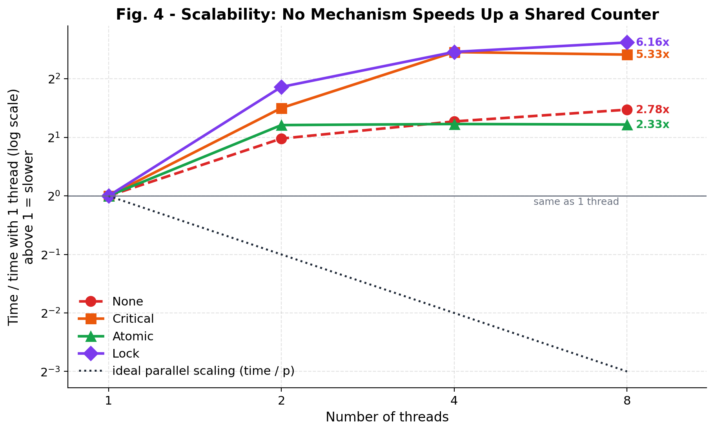</p>

**What the graph shows:**
- The dotted line is ideal parallel scaling: twice the threads, half the time. **Every measured line goes the opposite way**, up.
- At 8 threads: Atomic **2.33×**, Critical **5.33×** and Lock **6.16×** slower than with 1 thread. Even None (no locks at all) is **2.78×** slower.
- **Why?** In this program **100 % of the work is an update of one shared variable**. Synchronization forces those updates to happen one after another, so the work is effectively **serial**. By Amdahl's law, a fully serial job cannot speed up, and the extra threads only add **waiting and coordination**.
- **Why is even None slower?** The counter lives in one **cache line** (the 64-byte block a CPU core copies from memory). Each time a different core writes the counter, the line must move to that core and be invalidated in the others. With more threads, the line moves between cores constantly (**cache-line contention**), so each unprotected increment also costs more.

### 10.5 Cost of one increment

<p align="center">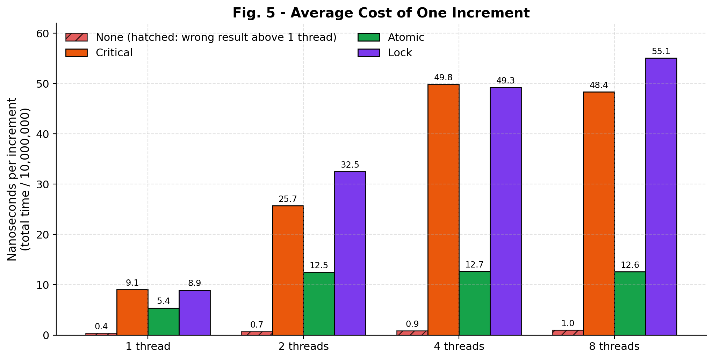</p>

**What the graph shows:**
- With **1 thread** (no contention), one protected increment costs **5.4 ns (Atomic)**, **9.1 ns (Critical)** and **8.9 ns (Lock)**, against **0.4 ns** for a plain `counter++`. This is the **base price** of each mechanism, even when no other thread is competing.
- With **2 or more threads**, Atomic settles at about **12.6 ns**, while Critical and Lock rise to **48–55 ns**.
- **Atomic stays flat** because it costs roughly one cache-line transfer per update, whatever the number of threads; only one core can own the line at a time. **Critical and Lock** must also manage a lock object. Under contention a waiting thread may be put to sleep by the operating system and woken up later. This is most likely why they cost about **4× more** than Atomic at 4–8 threads.

### 10.6 How much Atomic saves

<p align="center">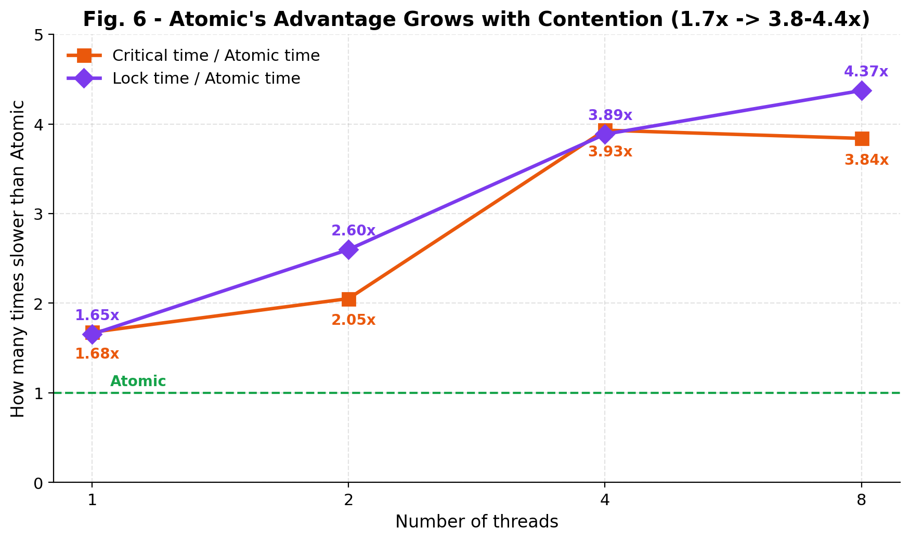</p>

**What the graph shows:** with 1 thread, Critical and Lock are about **1.7×** slower than Atomic. With 4–8 threads the gap widens to **3.8–4.4×**. **The more contention, the more Atomic's lock-free hardware approach pays off.** Critical and Lock behave almost the same, because `#pragma omp critical` is itself implemented with a lock in GCC's OpenMP runtime. Lock was the slowest of all at 8 threads (0.5510 s).

### 10.7 Barrier output order

<p align="center">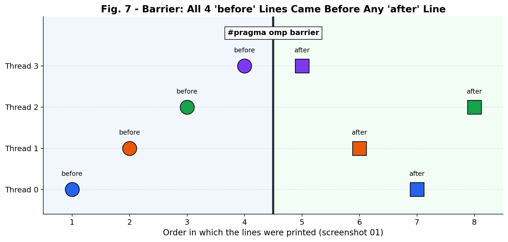</p>

**What the graph shows:** the 8 printed lines in the order they appeared. Positions 1–4 are all "before" (threads 0, 1, 2, 3), and positions 5–8 are all "after" (threads 3, 1, 0, 2). **No "after" line crossed the barrier early**, which is exactly the guarantee a barrier gives. The different order in the second half shows the barrier does not fix the order *inside* a phase.

### 10.8 Measured results vs the lab-manual sample

<p align="center">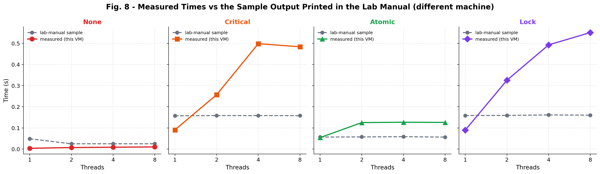</p>

| Measure | Lab-manual sample (another machine) | This experiment |
|:--|--:|--:|
| None, 1 thread | 0.0486 s | **0.0036 s** |
| Atomic, 1 → 8 threads | 0.0567 → 0.0565 s | **0.0541 → 0.1260 s** |
| Critical, 1 → 8 threads | 0.1571 → 0.1579 s | **0.0907 → 0.4837 s** |
| Lock, 1 → 8 threads | 0.1586 → 0.1603 s | **0.0895 → 0.5510 s** |
| None correct at 2 threads? | yes | **no (34.3 % lost)** |

The manual's sample is labelled "representative; values vary by machine". It is shown **only for comparison**; every result in this report is from the measured run.
- **What agrees:** the ranking is the same (None fastest but wrong; Atomic the fastest correct; Critical ≈ Lock the slowest), and Atomic beats Critical and Lock at every thread count.
- **What differs:** in the sample the times hardly change with the thread count. Here they **grow strongly**, because with 4 vCPUs the threads really run at the same time and compete for the counter. One likely reason for the flat sample is that fewer threads truly ran in parallel on that machine, which means less contention. That cannot be checked from the manual.

### 10.9 Overhead heat map

<p align="center">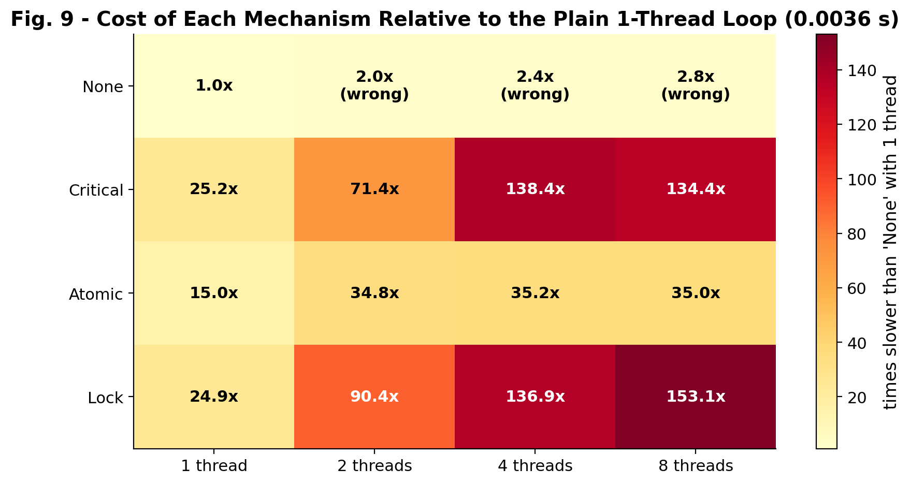</p>

**What the graph shows:** each cell is that run's time divided by the plain 1-thread loop (0.0036 s). Correct synchronization costs **15× (Atomic, 1 thread)** to **153× (Lock, 8 threads)** compared with the unprotected loop. The darkest cells, Critical and Lock with 4–8 threads, are where contention hurts most.

### 10.10 Summary dashboard

<p align="center">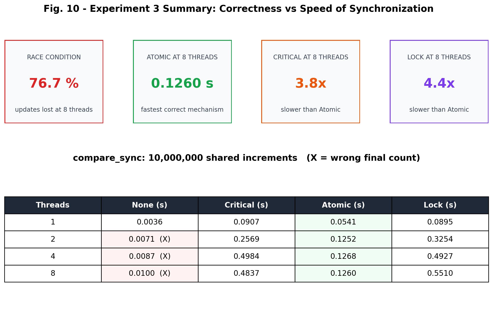</p>

---

## 11. Comparison of the Mechanisms

The manual's observation table (Section 10), filled in with **this experiment's measurements**:

| Mechanism | Correctness | Relative performance (measured) | Scalability (1 → 8 threads) |
|:--|:--|:--|:--|
| **None** (race) | ❌ Incorrect above 1 thread: 34 % → 77 % of updates lost | Fastest: 0.0036–0.0100 s | Poor: the error grows with threads, and it still slows down 2.8× |
| **Critical section** | ✅ Correct (10,000,000) | Slow: 0.091 s → 0.484 s; 3.8× Atomic at 8 threads | Poor: 5.3× slower |
| **Atomic operation** | ✅ Correct (10,000,000) | **Fastest correct**: 0.054 s → 0.126 s | Best of the correct ones: 2.3× slower, then flat from 2 to 8 threads |
| **Lock** (`omp_lock_t`) | ✅ Correct (10,000,000) | Slowest at 8 threads: 0.551 s; 4.4× Atomic | Poor: 6.2× slower |
| **Barrier** | Synchronization of phases only | Not timed | Waiting cost = time of the slowest thread |
| **Semaphore** | ✅ Correct (200,000) | Not timed (2 threads only) | Not measured |

**Which one to use:**

| Situation | Best choice |
|:--|:--|
| Update one number (`x++`, `x += v`) | **`#pragma omp atomic`** |
| Protect several lines or a complex structure | `#pragma omp critical` (simple) or `omp_lock_t` (more control, e.g. several different locks) |
| Allow up to *N* threads into a region | **Counting semaphore** |
| Phase 2 needs every thread's phase-1 result | **Barrier** |
| Sum or count across all threads | **`reduction(+:counter)`**: each thread keeps a private copy and they are combined once at the end, so there is almost no synchronization (used in Experiment 2) |

---

## 12. Observations and Limitations

**Observations:**

1. **Without synchronization the result is wrong** as soon as two threads share the counter, and the error grows with the thread count (34 % → 77 % lost).
2. **Every correct mechanism gave the exact right answer** in every run: Critical, Atomic, Lock (10,000,000) and the semaphore (200,000).
3. **Atomic was always the fastest correct mechanism**, and its time stopped growing after 2 threads.
4. **Critical and Lock behaved almost the same** and became 4× slower than Atomic under contention.
5. **No mechanism scaled.** For a shared counter, more threads always meant more time, because the updates must happen one at a time.
6. The barrier kept the two phases strictly apart, while the order inside each phase was random.

**Limitations of the measurements:**

| Limitation | Effect |
|:--|:--|
| Each configuration was run **once** | Small differences (such as Critical 0.4984 vs Lock 0.4927 at 4 threads) are within run-to-run noise |
| vCPU count, Ubuntu version and GCC version **not captured** | "4 vCPUs" is inferred from the 4-thread default team. At 8 threads the VM was most likely **oversubscribed** (more threads than vCPUs) |
| Compiled **without `-O2`** (as the manual says) | Absolute times are higher than optimized code; all versions are treated the same, so the comparison is fair |
| Times include **starting the thread team** | Matters most for the tiny None times (a few milliseconds) |
| Barrier and semaphore programs were **not timed** | Their cost is described, not measured |
| Run inside a **VMware VM** | Other host activity can affect timings slightly |

---

## 13. Troubleshooting and Issues Encountered

### 13.1 Issues seen during this experiment

No compile or run errors occurred. Two things could look like problems but are expected:

| What was seen | Screenshot | Explanation |
|:--|:-:|:--|
| `race.c` printed 3,121,112, but the benchmark's 4-thread None run printed 3,600,942 | 01, 03 | A race gives a **different wrong answer every run**, because it depends on thread timing. That randomness is the definition of a race condition |
| The None row is marked `Correct` at 1 thread but `INCORRECT` at 2, 4 and 8 | 03 | One thread cannot overlap with itself, so the race only appears with two or more threads |

### 13.2 General troubleshooting guide

| Problem | Solution |
|:--|:--|
| `#pragma omp ...` seems ignored (only 1 thread) | Add `-fopenmp` to the `gcc` command |
| `omp.h: No such file or directory` | `sudo apt install build-essential -y`, then repeat the OpenMP check |
| `undefined reference to sem_init` / `pthread_create` | Compile with `-pthread` |
| The race program sometimes prints the right answer | Use more threads (`OMP_NUM_THREADS=8 ./race`) or more iterations; with few threads the overlap is less frequent |
| Program hangs | Every `omp_set_lock` needs a matching `omp_unset_lock`, and every `sem_wait` a matching `sem_post` |
| Times vary a lot between runs | Close other programs, give the VM at least 4 cores, and run each test several times |
| Want a specific thread count for programs 1–4 | `export OMP_NUM_THREADS=8` before running, or `OMP_NUM_THREADS=8 ./critical` |

---

## 14. Important Terms

| Term | Meaning |
|:--|:--|
| **Shared variable** | A variable that every thread can read and write |
| **Race condition** | The result depends on the timing of threads that change shared data without coordination |
| **Read-modify-write** | The three steps hidden inside `counter++`: read, add, write back |
| **Synchronization** | Any mechanism that controls how threads access shared data or wait for each other |
| **Critical section** | Code that only one thread may run at a time (`#pragma omp critical`) |
| **Atomic operation** | An update done as one indivisible hardware instruction (`#pragma omp atomic`) |
| **Lock / mutex** | An object a thread must own before entering protected code (`omp_lock_t`) |
| **Semaphore** | A counter of permits: `sem_wait` takes one, `sem_post` returns one |
| **Binary semaphore** | A semaphore that starts at 1, so it behaves like a lock |
| **Barrier** | A point every thread must reach before any thread continues |
| **Contention** | Several threads trying to use the same lock or variable at the same moment |
| **Cache line** | The 64-byte block a CPU core copies from memory; shared writes make it move between cores |
| **Oversubscription** | Running more threads than there are CPU cores |
| **Scalability** | Whether a program gets faster as threads are added |
| **Reduction** | Each thread works on a private copy, and the copies are combined once at the end |

---

## 15. Conclusion

This experiment implemented a race condition and five ways of synchronizing threads, then measured their **correctness, speed and scalability** on a shared counter with 1, 2, 4 and 8 threads.

- **Correctness:** unprotected updates **lost 34–77 %** of the increments, and the loss grew with the thread count. **Critical sections, atomic operations, locks and semaphores were always correct**, and the barrier always kept the "before" and "after" phases apart.
- **Performance:** **atomic operations were the fastest correct mechanism** (0.054 s with 1 thread, about 0.126 s with 2–8). Critical sections and locks cost **3.8–4.4× more** under contention, up to 0.55 s.
- **Scalability:** **none of the mechanisms became faster with more threads.** When all the work is an update of one shared variable, synchronization makes the work serial, and extra threads only add waiting (Atomic 2.3×, Critical 5.3× and Lock 6.2× slower from 1 to 8 threads).

**Key lesson:** synchronization buys **correctness at the cost of parallelism**. Choose the **lightest mechanism that is correct** (atomic for simple updates; critical or locks only for larger blocks), and better still, **design the program so threads rarely share data at all**. A `reduction` gives each thread its own copy, and Experiment 2 showed it scaling to a **10×** speedup.

---

## 16. Repository Structure and Reproduction

```text
Experiment_3/
├── README.md                          ← this report
├── screenshots/                       ← 4 screenshots, renamed in execution order
│   ├── 01_openmp_check_race_critical_atomic_barrier_semaphore.png
│   ├── 02_compare_sync_compile_and_run.png
│   ├── 03_compare_sync_results_table.png
│   └── 04_compare_sync_observation_lines.png
├── src/
│   ├── race.c                         ← Program 1: no synchronization
│   ├── critical.c                     ← Program 2: #pragma omp critical
│   ├── atomic.c                       ← Program 3: #pragma omp atomic
│   ├── barrier.c                      ← Program 4: #pragma omp barrier
│   ├── semaphore.c                    ← Program 5: POSIX semaphore (pthreads)
│   └── compare_sync.c                 ← Program 6: None / Critical / Atomic / Lock x 1-8 threads
├── results/
│   ├── raw/
│   │   ├── programs_1_to_5_output.txt ← terminal output transcribed from screenshot 01
│   │   └── compare_sync_output.txt    ← terminal output transcribed from screenshots 02-04
│   ├── compare_sync_results.csv       ← measured times and final counts (16 runs)
│   ├── program_outputs.csv            ← results of programs 1-5
│   ├── derived_metrics.csv            ← ns per increment, lost %, slowdowns (written by the script)
│   └── manual_sample_output.csv       ← the manual's sample output, used only for Fig. 8
├── scripts/
│   ├── run_all.sh                     ← compile and run every program in order
│   └── generate_graphs.py             ← matplotlib graph generator
└── graphs/                            ← 10 generated figures
```

**Quick reproduction (Ubuntu with `build-essential`):**

```bash
bash scripts/run_all.sh                 # compiles and runs programs 1-6

# or one at a time
gcc src/race.c         -fopenmp -o race         && ./race
gcc src/critical.c     -fopenmp -o critical     && ./critical
gcc src/atomic.c       -fopenmp -o atomic       && ./atomic
gcc src/barrier.c      -fopenmp -o barrier      && ./barrier
gcc src/semaphore.c    -pthread -o semaphore    && ./semaphore
gcc src/compare_sync.c -fopenmp -o compare_sync && ./compare_sync

# Regenerate graphs
pip install matplotlib pandas numpy
python scripts/generate_graphs.py
```

---

## 17. References

1. OpenMP Architecture Review Board, *OpenMP Application Programming Interface Specification*, Version 5.2, 2021 (`critical`, `atomic`, `barrier`, lock routines).
2. IEEE Std 1003.1 (POSIX.1), *POSIX Threads* and *Semaphores* (`sem_init`, `sem_wait`, `sem_post`), The Open Group.
3. GNU Project, *GNU libgomp — GNU Offloading and Multi-Processing Runtime Library Manual*.
4. B. Barney, *OpenMP* and *POSIX Threads Programming* tutorials, Lawrence Livermore National Laboratory.
5. M. Herlihy and N. Shavit, *The Art of Multiprocessor Programming*, 2nd ed., Morgan Kaufmann, 2020.
6. A. Grama, A. Gupta, G. Karypis and V. Kumar, *Introduction to Parallel Computing*, 2nd ed., Addison-Wesley, 2003.
7. G. M. Amdahl, "Validity of the single processor approach to achieving large scale computing capabilities," *AFIPS Conference Proceedings*, vol. 30, pp. 483–485, 1967.
8. *Experiment: Analyze Synchronization Mechanisms in Parallel Programs*, Lab Manual, PGC Laboratory.

---

<div align="center"><sub>Experiment 3 · Parallel Computing and GPU Programming Laboratory</sub></div>
