<div align="center">

# Experiment 4 — Analyze Cache Coherence (MSI, MESI, MOESI) and NUMA Memory Access Performance
### Coherence Protocol Simulation · False Sharing (Adjacent vs Padded Counters) · NUMA Memory Sweep with numactl

**Course:** Parallel Computing and GPU Programming (PGC) Laboratory
**Tools:** Python 3 (protocol simulator) · C + OpenMP (`-O2 -fopenmp`) · numactl
**Platform:** Ubuntu 26.04.1 guest on VMware Workstation · Intel Core i5-13400 host · 2 vCPUs · 1 NUMA node


-1.64x-ea580c)

</div>

---

## Abstract

Every core of a multi-core processor has its **own private cache**. When two cores use the same memory, a **cache coherence protocol** keeps their copies consistent. This experiment studies three such protocols (**MSI, MESI and MOESI**) and two performance effects that come from them: **false sharing** and **NUMA memory placement**. One example is used throughout: **two threads, each incrementing its own counter**, with the two counters either on the **same 64-byte cache line (adjacent)** or on **separate lines (padded)**.

Three parts were run on an Ubuntu VM with 2 vCPUs:

- **Part A, protocol simulation** (`coherence_sim.py`, 1,000 iterations):
  - With adjacent counters, every protocol needed **about 4,000 bus transactions and 1,999 invalidations**; with padded counters, only **2–4 bus transactions and 0 invalidations**.
  - **MESI** saved the upgrade for private data ("silent" E→M writes).
  - **MOESI** replaced all **1,999 write-backs to memory** with cache-to-cache transfers.
- **Part B1, false sharing** (`false_sharing.c`, 2 threads, 100,000,000 increments): the padded layout was faster in **all 4 measured pairs**. The medians of the three repeats were **0.0242 s (adjacent)** and **0.0148 s (padded)**, so adjacent was **1.64× slower**.
  - **Caution:** a 1-thread control run showed a similar gap (1.43×), even though false sharing is impossible with one thread. Part of the measured difference is therefore a run-order (warm-up) effect, not false sharing.
- **Part B2, memory sweep** (`numa_sweep.c`, 256 MB, 4 passes): a second thread gave only a **1.13× speedup**, from **19.4 to 21.9 GB/s**. The task is limited by memory bandwidth.
  - The VM exposes **only one NUMA node**, so the **remote-memory test (`--membind=1`) could not be run**. Binding to node 0 (local) gave the same times as the default within run-to-run noise.

---

## Table of Contents

1. [Introduction](#1-introduction)
2. [Aim and Objectives](#2-aim-and-objectives)
3. [Basic Concepts](#3-basic-concepts)
4. [Experimental Setup](#4-experimental-setup)
5. [Methodology and Workflow](#5-methodology-and-workflow)
6. [Environment Preparation](#6-environment-preparation)
7. [Part A — Protocol Simulation (coherence_sim.py)](#7-part-a--protocol-simulation-coherence_simpy)
8. [Part B1 — False Sharing (false_sharing.c)](#8-part-b1--false-sharing-false_sharingc)
9. [Part B2 — NUMA Memory Sweep (numa_sweep.c)](#9-part-b2--numa-memory-sweep-numa_sweepc)
10. [Part C — Comparison Program (compare_numa.c)](#10-part-c--comparison-program-compare_numac)
11. [Consolidated Results](#11-consolidated-results)
12. [Performance Analysis](#12-performance-analysis)
13. [Comparison of Protocols, Layouts and Placement](#13-comparison-of-protocols-layouts-and-placement)
14. [Observations and Limitations](#14-observations-and-limitations)
15. [Troubleshooting and Issues Encountered](#15-troubleshooting-and-issues-encountered)
16. [Important Terms](#16-important-terms)
17. [Conclusion](#17-conclusion)
18. [Repository Structure and Reproduction](#18-repository-structure-and-reproduction)
19. [References](#19-references)

---

## 1. Introduction

Experiment 3 showed that threads sharing **one variable** must be synchronized. This experiment looks one level lower, at the **hardware**, and shows that threads can slow each other down even when they **do not share any variable at all**.

```text
   Core 0                 Core 1
     |                      |
 [ cache 0 ]            [ cache 1 ]        each core keeps private COPIES of memory
     |                      |
 ===============  shared bus  ===============   caches watch ("snoop") each other here
                     |
              [ main memory ]
```

Two facts make this happen:

1. **Caches copy memory in blocks of 64 bytes**, called **cache lines**, not one variable at a time.
2. When one core **writes** to a line, the hardware must make sure no other core keeps a **stale copy**. This is the job of the **cache coherence protocol**: it invalidates or updates the other copies.

If two threads write two **different** variables that happen to sit in the **same** 64-byte line, every write by one thread invalidates the other thread's copy. The line bounces between the cores even though the threads never touch each other's data. This is **false sharing**. The answer stays correct, but time is lost.

A second effect appears on large servers with several processor sockets: **NUMA (Non-Uniform Memory Access)**. Each socket has its own memory, and reaching another socket's memory (**remote**) is slower than reaching its own (**local**).

The experiment therefore has three parts:

| Part | Question | Tool |
|:-:|:--|:--|
| A | How much bus traffic do MSI, MESI and MOESI generate with adjacent vs padded counters? | Python simulator (real CPUs cannot switch protocol) |
| B1 | How much does false sharing cost on the real machine? | `false_sharing.c` (OpenMP) |
| B2 | Does local vs remote memory placement change the speed of a memory-bound loop? | `numa_sweep.c` + `numactl` |

---

## 2. Aim and Objectives

**Aim** (from the lab manual): To study how cache coherence protocols (MSI, MESI and MOESI) keep the caches of a multi-core processor consistent, and to evaluate the performance effect of coherence traffic (false sharing) and of NUMA memory placement (local vs remote memory).

**Objectives:**

1. Record the system's CPU, memory and **NUMA topology** (`lscpu`, `numactl --hardware`).
2. Simulate **MSI, MESI and MOESI** for the two-counter example and count bus transactions, invalidations, write-backs and cache-to-cache transfers.
3. Measure the time of the two-counter example with **adjacent** and **padded** counters (false sharing).
4. Measure a **memory sweep** with 1 and 2 threads, with default placement and with `numactl` **local** placement (and remote placement, if the machine has more than one NUMA node).
5. Judge each case on **correctness, performance and scalability**, and report the ratios **adjacent / padded** and **remote / local**.

---

## 3. Basic Concepts

### 3.1 Cache line states

| State | Meaning | Memory up to date? | Other caches may hold it? | Protocols |
|:-:|:--|:-:|:-:|:--|
| **M** Modified | Only valid copy, changed (dirty) | No | No | MSI, MESI, MOESI |
| **O** Owned | Dirty, but other caches hold Shared copies; the owner supplies the data | No | Yes (as S) | MOESI only |
| **E** Exclusive | Only copy, clean | Yes | No | MESI, MOESI |
| **S** Shared | Clean copy, possibly in several caches | Yes (or the owner has it) | Yes | all |
| **I** Invalid | Not a valid copy | — | — | all |

### 3.2 Bus messages counted by the simulator

| Event | When it happens |
|:--|:--|
| **BusRd** | A core reads a line it does not have (read miss) |
| **BusRdX** | A core writes a line it does not have (write miss, "read for ownership") |
| **BusUpgr** | A core writes a line it holds as Shared: the other copies must be invalidated first |
| **Invalidation** | Another cache's copy is thrown away |
| **Write-back** | A dirty line is written to main memory so another core can read it (MSI, MESI) |
| **Cache-to-cache** | The owner sends a dirty line directly to another cache, without updating memory (MOESI) |
| **Silent E→M** | A write to an Exclusive line: no bus message at all (MESI, MOESI) |

### 3.3 What each protocol adds

| Protocol | Added idea | Saves |
|:--|:--|:--|
| **MSI** | Basic: Modified / Shared / Invalid | — (a first write always needs a bus upgrade) |
| **MESI** | **Exclusive** state: a line nobody else has can be written silently | The upgrade for **private** data |
| **MOESI** | **Owned** state: a dirty line can be shared without writing it to memory | The **write-back to memory** when another core reads a dirty line |

Real processors use fixed variants (Intel uses MESIF, AMD uses MOESI), so the protocols cannot be switched on real hardware. That is why Part A uses a simulator.

### 3.4 NUMA

```text
   NUMA node 0                         NUMA node 1
 [CPUs] -- [local memory 0]  <== interconnect ==>  [local memory 1] -- [CPUs]
            fast (local)                              slow from node 0 (remote)
```

- `numactl --cpunodebind=N` runs the threads on node N; `numactl --membind=N` allocates memory on node N.
- Linux normally places a page on the node of the thread that **first touches** it (first-touch policy).

### 3.5 Formulas

| Metric | Formula |
|:--|:--|
| Bus transactions | BusRd + BusRdX + BusUpgr |
| Cost of false sharing | $\dfrac{T_{\text{adjacent}}}{T_{\text{padded}}}$ |
| Cost of NUMA placement | $\dfrac{T_{\text{remote}}}{T_{\text{local}}}$ |
| Speedup | $\dfrac{T_{1\ \text{thread}}}{T_{2\ \text{threads}}}$ |
| Effective sweep bandwidth | $\dfrac{4\ \text{passes} \times 256\ \text{MiB}}{T}$: 1 GiB of 64-byte cache lines brought through the caches |

---

## 4. Experimental Setup

### 4.1 Environment (from screenshots 01–03)

| Item | Value | Command |
|:--|:--|:--|
| Host CPU | **13th Gen Intel Core i5-13400** | `lscpu` |
| Hypervisor | **VMware**, full virtualization | `lscpu` |
| Guest OS | **Ubuntu 26.04.1 LTS** (resolute), user `master`, host `master` | `lsb_release -a` |
| vCPUs | **2** (2 sockets × 1 core × 1 thread) | `nproc`, `lscpu` |
| Memory | **5.2 GiB** RAM + 3.3 GiB swap (2.6 GiB available) | `free -h` |
| Disk | `/dev/sda2` 20 GB, 62 % used | `df -h /` |
| NUMA | **1 node** (node 0: CPUs 0–1, 5,360 MB, distance 10) | `numactl --hardware` |
| Compiler | **GCC 15.2.0**, flags `-O2 -fopenmp` | `gcc --version` |
| OpenMP | OpenMP OK | `gcc -E -fopenmp` check |
| Python | **3.14.4** | `python3 --version` |
| numactl | **2.0.19** | `numactl --version` |
| Working folder | `~/cache_numa_experiment` | `pwd` |
| Date | 5 November 2026, about 15:29–15:32 IST (screenshot times) | — |

### 4.2 Manual vs actual

| Item | Manual | Actual | Effect |
|:--|:--|:--|:--|
| Guest OS | Ubuntu 22.04 LTS | Ubuntu **26.04.1** LTS | None for these programs |
| vCPUs / RAM | 4 vCPUs (2 sockets × 2 cores), 4 GB | **2 vCPUs** (2 sockets × 1 core), 5.2 GiB | Only 1 and 2 threads could be tested; no 4-thread run |
| Virtual NUMA nodes (`.vmx` settings, Step 5.4) | 2 nodes | **1 node** | **Remote memory (`--membind=1`) could not be tested.** The manual says to continue with the false-sharing part in this case |
| `compare_numa.c` | 1, 2, 4 threads; 512 MB; table with a Correctness column | **1, 2 threads; 256 MB**; simpler table | Fits the 2-vCPU VM; the counters were still checked (Total = 100,000,000) |
| `numa_sweep.c` default size | 512 MB (`memset` first touch) | 256 MB (a loop does the first touch) | Same behaviour; the size was given as an argument (`256`) |
| `coherence_sim.py` | Appendix A version, also prints a state trace | Shorter version, prints the totals only | **Totals identical** to the manual's Section 9.1 table |
| Repeats | 3 times, keep the median | 3 repeated batches (+ 1 single run) | Medians reported as the main results |
| Step 12 (`taskset`, one thread per node) | optional | **Not run** | — |

---

## 5. Methodology and Workflow

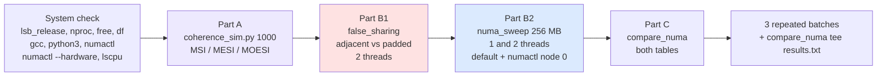

Each C program followed the cycle `nano <file>.c` → `gcc -O2 <file>.c -fopenmp -o <file>` → run. The six screenshots were renamed in execution order (`01` … `06`) and saved in [`screenshots/`](screenshots). Every output was typed into [`results/raw/`](results/raw); [`compare_numa_results.txt`](results/raw/compare_numa_results.txt) is the file saved on the VM by `./compare_numa | tee results.txt`.

---

## 6. Environment Preparation

| Step | Command | Purpose | Result |
|:-:|:--|:--|:--|
| 1 | `sudo apt install build-essential numactl hwloc python3 -y` | Install the tools | Done (the end of an `apt` run is visible at the top of screenshot 02) |
| 2 | `lsb_release -a`, `nproc`, `free -h`, `df -h /` | Record OS, CPUs, memory, disk | Ubuntu 26.04.1, **2** CPUs, 5.2 GiB, 20 GB |
| 3 | `gcc --version`, `python3 --version`, `numactl --version` | Record tool versions | GCC 15.2.0, Python 3.14.4, numactl 2.0.19 |
| 4 | `echo '#include <omp.h>' \| gcc -E -fopenmp -xc - > /dev/null && echo "OpenMP OK"` | Check OpenMP support | **OpenMP OK** |
| 5 | `numactl --hardware` | List NUMA nodes | **1 node**: node 0 = CPUs 0, 1; 5,360 MB |
| 6 | `lscpu` | CPU model and layout | i5-13400, 2 sockets × 1 core, VMware |
| 7 | `mkdir -p ~/cache_numa_experiment && cd ~/cache_numa_experiment` | Working folder | `/home/master/cache_numa_experiment` |

**What step 5 means for this experiment:** `available: 1 nodes (0)` and a single distance value of `10` mean there is **no remote memory** in this VM. VMware shows two *sockets*, but without the extra `.vmx` settings it does not create two virtual *NUMA nodes*.

| | |
|:-:|:-:|
| 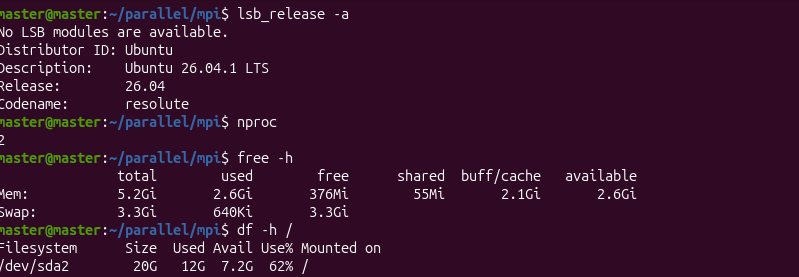<br><em>01 — <code>lsb_release</code>, <code>nproc</code> = 2, <code>free -h</code>, <code>df -h</code></em> | 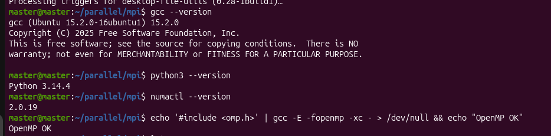<br><em>02 — GCC 15.2.0, Python 3.14.4, numactl 2.0.19, OpenMP OK</em> |

<p align="center">
  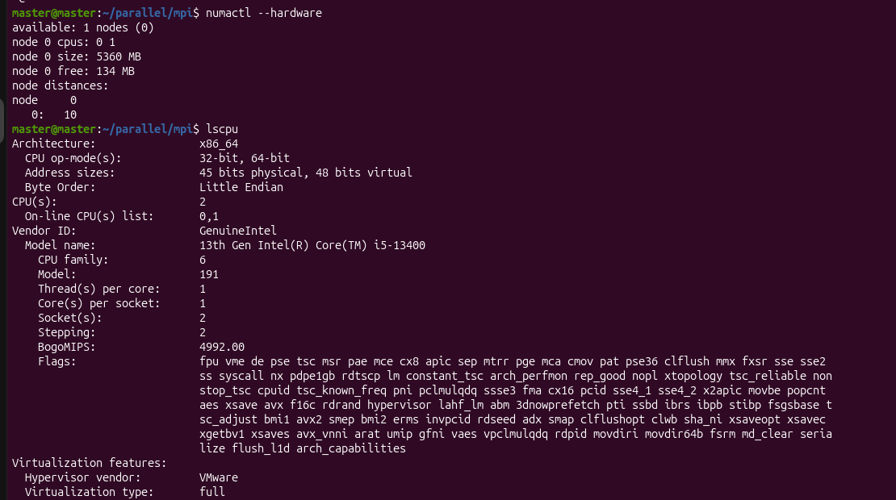<br>
  <em>03 — <code>numactl --hardware</code> (1 node, CPUs 0-1) and <code>lscpu</code> (i5-13400, 2 sockets x 1 core, VMware).</em>
</p>

---

## 7. Part A — Protocol Simulation (`coherence_sim.py`)

### 7.1 What the simulator does

Full source: [`src/coherence_sim.py`](src/coherence_sim.py). It models **two cores** and **two cache lines (A, B)** and repeats this trace `iterations` times:

```python
x, y = ('A', 'A') if layout == 'adjacent' else ('A', 'B')   # same line, or separate lines

for _ in range(iterations):
    access(0, x, 'R');  access(0, x, 'W')     # core 0: counter_x = counter_x + 1
    access(1, y, 'R');  access(1, y, 'W')     # core 1: counter_y = counter_y + 1
```

`access()` applies the protocol rules:
- **Read miss:** count a BusRd. If the other core holds the line **M**, MSI and MESI force a **write-back**, while MOESI turns the other copy into **O** and counts a **cache-to-cache** transfer. A read with no other copy loads the line as **E** (MESI, MOESI) or **S** (MSI).
- **Write:** a write to **M** is free. A write to **E** is a **silent** E→M change. A write to **S** costs a **BusUpgr**. Any other copy is **invalidated**.

```bash
python3 coherence_sim.py 1000
```

### 7.2 Output (1,000 iterations = 4,000 memory operations)

| Layout | Protocol | BusRd | BusRdX | BusUpgr | **Bus transactions** | Invalidations | Write-backs | Cache-to-cache | Silent E→M |
|:--|:--|--:|--:|--:|--:|--:|--:|--:|--:|
| adjacent | MSI | 2,000 | 0 | 2,000 | **4,000** | 1,999 | **1,999** | 0 | 0 |
| adjacent | MESI | 2,000 | 0 | 1,999 | **3,999** | 1,999 | **1,999** | 0 | 1 |
| adjacent | MOESI | 2,000 | 0 | 1,999 | **3,999** | 1,999 | **0** | **1,999** | 1 |
| padded | MSI | 2 | 0 | 2 | **4** | 0 | 0 | 0 | 0 |
| padded | MESI | 2 | 0 | 0 | **2** | 0 | 0 | 0 | 2 |
| padded | MOESI | 2 | 0 | 0 | **2** | 0 | 0 | 0 | 2 |

These totals are **identical** to the table in the lab manual (Section 9.1). This is expected: the simulation is deterministic, and it confirms the program was typed and run correctly.

### 7.3 State of line A, step by step (adjacent layout, first two iterations)

The short version of the simulator used here prints only totals. The table below is the manual's state trace (Section 9.1). It was checked rule by rule against `src/coherence_sim.py` and matches for all three protocols. Each cell is *core 0 / core 1*.

| # | Operation | MSI | MESI | MOESI |
|:-:|:--|:-:|:-:|:-:|
| 1 | core 0 reads its counter | S / I | **E** / I | **E** / I |
| 2 | core 0 writes its counter | M / I | M / I *(silent)* | M / I *(silent)* |
| 3 | core 1 reads its counter | S / S *(write-back)* | S / S *(write-back)* | **O** / S *(cache-to-cache)* |
| 4 | core 1 writes its counter | I / M | I / M | I / M |
| 5 | core 0 reads its counter | S / S *(write-back)* | S / S *(write-back)* | S / **O** *(cache-to-cache)* |
| 6 | core 0 writes its counter | M / I | M / I | M / I |
| 7 | core 1 reads its counter | S / S | S / S | O / S |
| 8 | core 1 writes its counter | I / M | I / M | I / M |

**Reading the table:** from step 3 on, the line **ping-pongs**: every write turns the other core's copy to **I**, and the next read must fetch it back. This is false sharing at the protocol level. The two counters are different variables, but they live in one line.

### Part A Screenshot

<p align="center">
  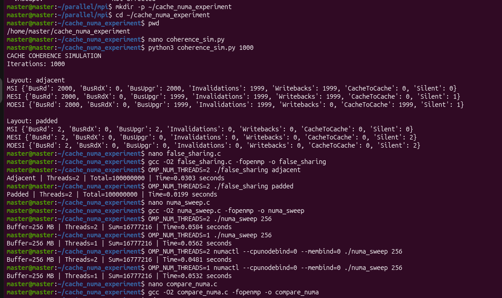<br>
  <em>04 — <code>python3 coherence_sim.py 1000</code>, then the first false-sharing and memory-sweep runs (including the two <code>numactl</code> runs).</em>
</p>

---

## 8. Part B1 — False Sharing (`false_sharing.c`)

### 8.1 Program

Full source: [`src/false_sharing.c`](src/false_sharing.c).

```c
int stride = (argc > 1 && argv[1][0] == 'p') ? 8 : 1;   // 'padded' -> 8 longs = 64 bytes apart
long *cnt = aligned_alloc(64, bytes);                    // array starts on a cache-line boundary

#pragma omp parallel
{
    volatile long *p = &cnt[omp_get_thread_num() * stride];   // each thread: its OWN counter
    for (long i = 0; i < N / nt; i++)
        (*p)++;                                               // read-modify-write, every iteration
}
```

| Detail | Why it matters |
|:--|:--|
| `stride = 1` (adjacent) | Thread 0 uses `cnt[0]` and thread 1 uses `cnt[1]`: 8 bytes apart, so in the **same** 64-byte line |
| `stride = 8` (padded) | Thread 1 uses `cnt[8]`, 64 bytes away, so on its **own** line |
| `aligned_alloc(64, …)` | The array starts exactly at a line boundary, so the layouts are what we expect |
| `volatile` | Forces a real memory read and write on every iteration; otherwise `-O2` would keep the counter in a register and there would be no cache traffic to measure |
| No shared variable | The answer is always correct (100,000,000). Only the **speed** can change |

### 8.2 Results (2 threads, 100,000,000 increments in total)

| Run | Adjacent (s) | Padded (s) | Adjacent / Padded | Total |
|:--|--:|--:|--:|:-:|
| single run | 0.0303 | 0.0199 | 1.52× | 100,000,000 ✅ |
| repeat 1 | 0.0230 | 0.0149 | 1.54× | 100,000,000 ✅ |
| repeat 2 | 0.0242 | 0.0148 | 1.64× | 100,000,000 ✅ |
| repeat 3 | 0.0252 | 0.0113 | 2.23× | 100,000,000 ✅ |
| **median of the 3 repeats** | **0.0242** | **0.0148** | **1.64×** | — |

Both layouts were **always correct**, and **padded was faster in every pair**. Section 12.6 explains why this ratio should be read with care.

| | |
|:-:|:-:|
| 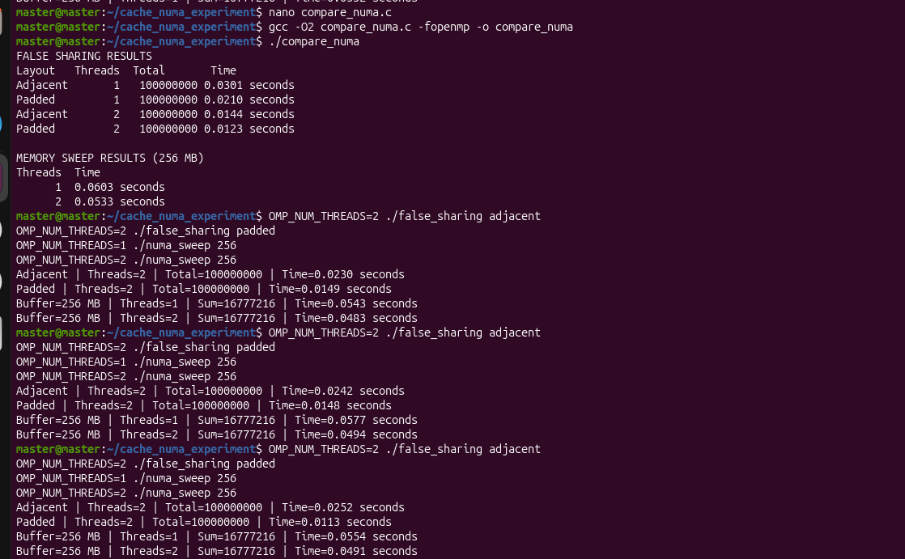<br><em>05 — first <code>compare_numa</code> run and the three repeated batches</em> | 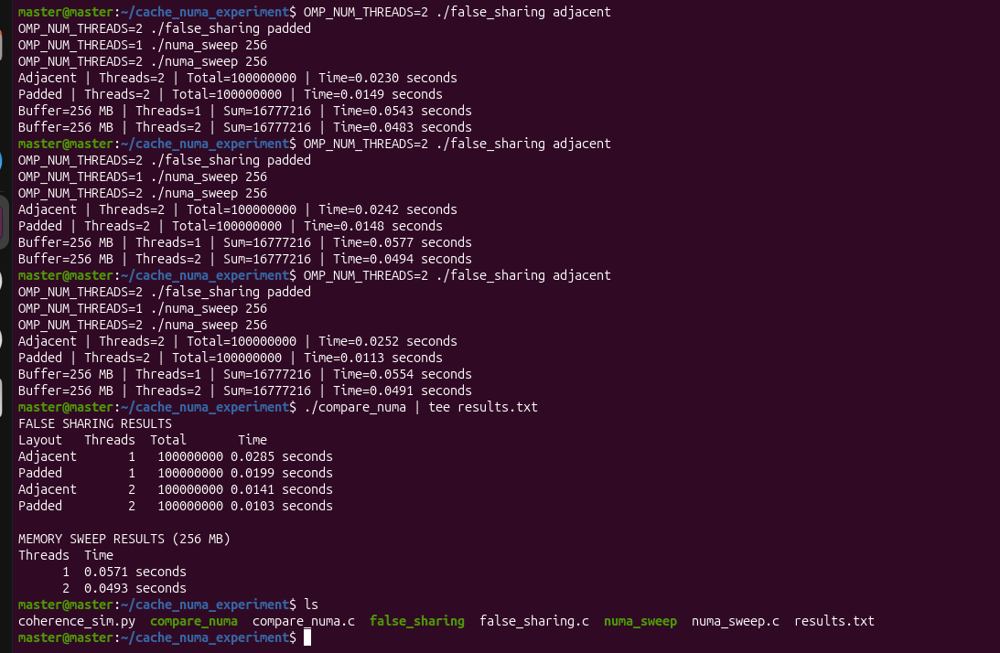<br><em>06 — the repeated batches and <code>./compare_numa | tee results.txt</code></em> |

---

## 9. Part B2 — NUMA Memory Sweep (`numa_sweep.c`)

### 9.1 Program

Full source: [`src/numa_sweep.c`](src/numa_sweep.c).

```c
char *buf = malloc(n);                        // n = 256 MB
for (size_t i = 0; i < n; i++) buf[i] = 1;    // first touch: pages are placed now (by numactl's policy)

for (int pass = 0; pass < 4; pass++) {
    #pragma omp parallel for reduction(+:sum)
    for (size_t i = 0; i < n; i += 64)        // ONE byte per 64-byte cache line
        sum += buf[i];
}
```

- It reads **one byte from every cache line**, so almost all the time goes into **bringing lines from memory**. This makes the loop **memory-bound**.
- Expected sum: $256 \times 2^{20} / 64 \times 4 = 16{,}777{,}216$. Every run printed exactly this ✅.
- `reduction(+:sum)` gives each thread a private sum, so there is no race and almost no synchronization.

### 9.2 Results (256 MB, 4 passes)

| Run | Placement | 1 thread (s) | 2 threads (s) |
|:--|:--|--:|--:|
| single runs | default | 0.0562 | 0.0584 *(first run after compiling)* |
| single runs | `numactl --cpunodebind=0 --membind=0` (**local**) | **0.0532** | **0.0481** |
| repeat 1 | default | 0.0543 | 0.0483 |
| repeat 2 | default | 0.0577 | 0.0494 |
| repeat 3 | default | 0.0554 | 0.0491 |
| **median of the 3 repeats** | default | **0.0554** | **0.0491** |
| **remote** (`--membind=1`) | — | **Not possible: the VM has only 1 NUMA node** | |

- **Speedup** with 2 threads: $0.0554 / 0.0491 = 1.13\times$ (ideal would be 2×).
- **Effective bandwidth:** 1 GiB of cache lines / time = **19.4 GB/s** (1 thread) → **21.9 GB/s** (2 threads).

---

## 10. Part C — Comparison Program (`compare_numa.c`)

Full source: [`src/compare_numa.c`](src/compare_numa.c). It runs the two-counter test (adjacent and padded, **1 and 2 threads**) and the 256 MB sweep (1 and 2 threads) in **one process**:

```c
int threads[] = {1, 2};
for (int i = 0; i < 2; i++)
    for (int stride = 1; stride <= 8; stride *= 8)        // adjacent first, then padded
        t = counters(threads[i], stride, &total);
...
for (int i = 0; i < 2; i++) t = sweep(buf, n, threads[i]);
```

| | Run 1 (screenshot 05) | Run 2 (`results.txt`, screenshot 06) |
|:--|--:|--:|
| Adjacent, 1 thread | 0.0301 s | 0.0285 s |
| Padded, 1 thread | 0.0210 s | 0.0199 s |
| Adjacent, 2 threads | 0.0144 s | 0.0141 s |
| Padded, 2 threads | 0.0123 s | 0.0103 s |
| Sweep, 1 thread | 0.0603 s | 0.0571 s |
| Sweep, 2 threads | 0.0533 s | 0.0493 s |
| All totals | 100,000,000 ✅ | 100,000,000 ✅ |

**Important check:** with **1 thread**, the adjacent and padded runs do **exactly the same work**. There is one counter, `cnt[0]`, in the same 64-byte block, and no other core to share with. Yet "adjacent" was **1.43× slower** in both runs. This 1-thread pair is a **control**, and it shows that part of the adjacent/padded gap on this VM does **not** come from false sharing (see Section 12.6).

---

## 11. Consolidated Results

### 11.1 Results to record (manual Section 9.3)

| Run | Time (s) | Source |
|:--|--:|:--|
| adjacent, 2 threads (Program 2) | **0.0242** | median of 3 repeats |
| padded, 2 threads (Program 2) | **0.0148** | median of 3 repeats |
| memory sweep, LOCAL (`--membind=0`), 1 thread | **0.0532** | single run |
| memory sweep, LOCAL (`--membind=0`), 2 threads | **0.0481** | single run |
| memory sweep, REMOTE (`--membind=1`), 1 thread | **Not possible** | VM has 1 NUMA node |
| memory sweep, REMOTE (`--membind=1`), 2 threads | **Not possible** | VM has 1 NUMA node |
| adjacent, one thread on each node (optional) | **Not run** | 1 NUMA node; `taskset` step skipped |

### 11.2 Ratios (manual: "Ratios to report")

| Ratio | Value | Meaning |
|:--|--:|:--|
| adjacent / padded, 2 threads (standalone medians) | **1.64×** | upper limit of the false-sharing cost on this VM (includes a run-order effect) |
| adjacent / padded, **1 thread** (compare_numa control) | 1.43× | same work, so this part is **not** false sharing |
| adjacent / padded, 2 threads (compare_numa) | 1.17× / 1.37× | smaller than the 1-thread control |
| remote / local | **not measurable** | one NUMA node only |
| memory sweep speedup, 1 → 2 threads | **1.13×** | memory-bound |

### 11.3 Simulation summary

| | MSI | MESI | MOESI |
|:--|--:|--:|--:|
| Bus transactions, adjacent → padded | 4,000 → **4** | 3,999 → **2** | 3,999 → **2** |
| Invalidations, adjacent → padded | 1,999 → 0 | 1,999 → 0 | 1,999 → 0 |
| Write-backs to memory (adjacent) | 1,999 | 1,999 | **0** |
| Cache-to-cache transfers (adjacent) | 0 | 0 | **1,999** |
| Silent E→M writes (padded) | 0 | **2** | **2** |

Raw data: [`results/coherence_sim_results.csv`](results/coherence_sim_results.csv) · [`results/false_sharing_runs.csv`](results/false_sharing_runs.csv) · [`results/memory_sweep_runs.csv`](results/memory_sweep_runs.csv) · [`results/summary_metrics.csv`](results/summary_metrics.csv) · [`results/system_info.csv`](results/system_info.csv)

---

## 12. Performance Analysis

All graphs are generated with **matplotlib** by [`scripts/generate_graphs.py`](scripts/generate_graphs.py) from the CSV files in `results/`.

### 12.1 Cache lines and the two-counter example

<p align="center">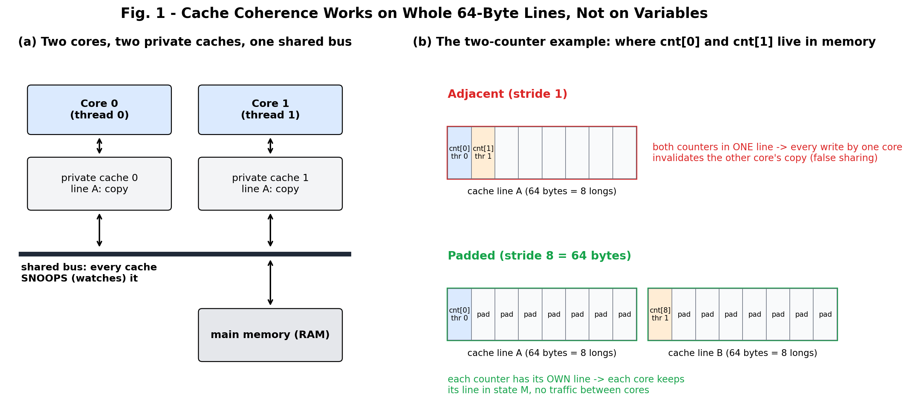</p>

**What the figure shows:** **(a)** each core has a private copy of line A, and the caches watch the shared bus. **(b)** With **adjacent** counters, `cnt[0]` and `cnt[1]` share one 64-byte line, so the two cores fight over it. With **padded** counters, `cnt[0]` and `cnt[8]` are 64 bytes apart, each in its own line, and each core can keep its line in state M with no traffic.

### 12.2 Protocol state trace

<p align="center">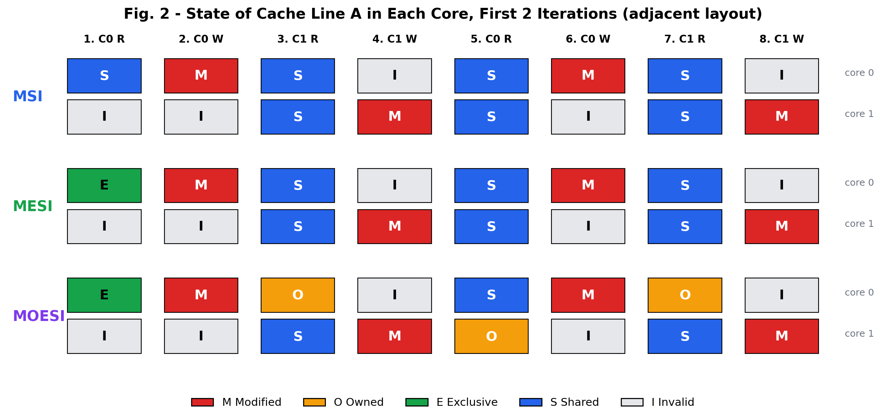</p>

**What the figure shows:**
- **Step 1:** MSI loads the line as **S**, while MESI and MOESI load it as **E** (green). In MESI and MOESI, the write in step 2 is therefore **silent**.
- **Steps 3 and 5:** where MSI and MESI fall back to **S/S** (after a write-back to memory), MOESI keeps the dirty data in an **O** (orange) owner that hands it straight to the other cache.
- **From step 3 on**, every protocol shows the same pattern: a red **M** jumps from one core to the other, and the losing core's copy turns grey (**I**). This is the cache line **ping-ponging**.

### 12.3 Coherence events with false sharing

<p align="center">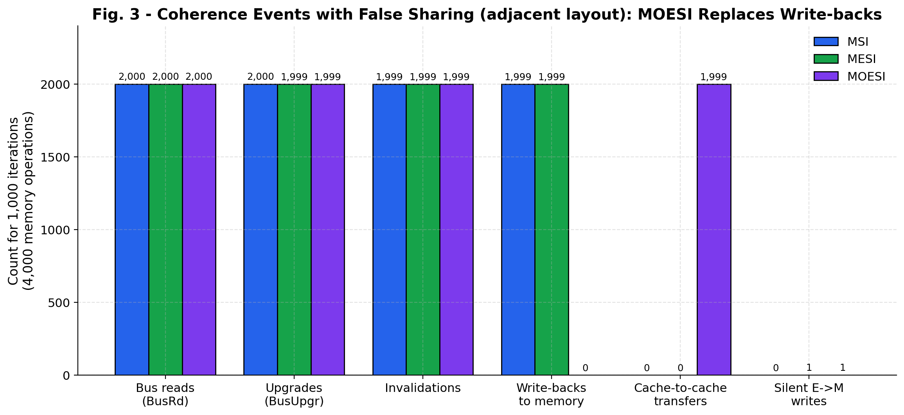</p>

**What the graph shows:**
- With adjacent counters, all three protocols need about **2,000 bus reads, 2,000 upgrades and 1,999 invalidations**: roughly **two bus messages for every one of the 4,000 memory operations**.
- **MESI** saves only **one** upgrade (the very first write), because after that the line is never private again.
- **MOESI** has the same number of bus transactions, but its **1,999 write-backs to memory become 1,999 cache-to-cache transfers**. MOESI does not reduce coherence traffic; it reduces **memory** traffic, because the dirty line travels cache to cache instead of through RAM.

### 12.4 Adjacent vs padded

<p align="center">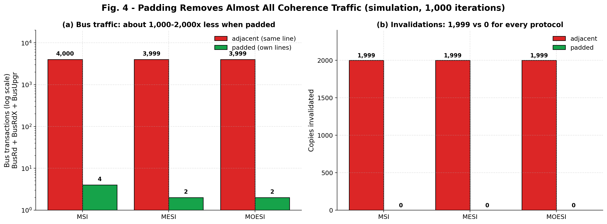</p>

**What the graph shows:**
- **(a)** Padding cuts bus transactions from **about 4,000 to 2–4**, roughly 1,000–2,000 times fewer (log scale). The 2–4 that remain are the first-time misses that load each line once.
- MSI needs **4** where MESI and MOESI need **2**, because MSI must upgrade S→M on the first write of each line, while MESI and MOESI load the line as E and write it silently.
- **(b)** Invalidations drop from **1,999 to 0** for every protocol.
- **Lesson:** **data layout matters more than the protocol.** Choosing a better protocol saves a single message per line, while padding removes almost all of the traffic.

### 12.5 False sharing on the real VM (2 threads)

<p align="center">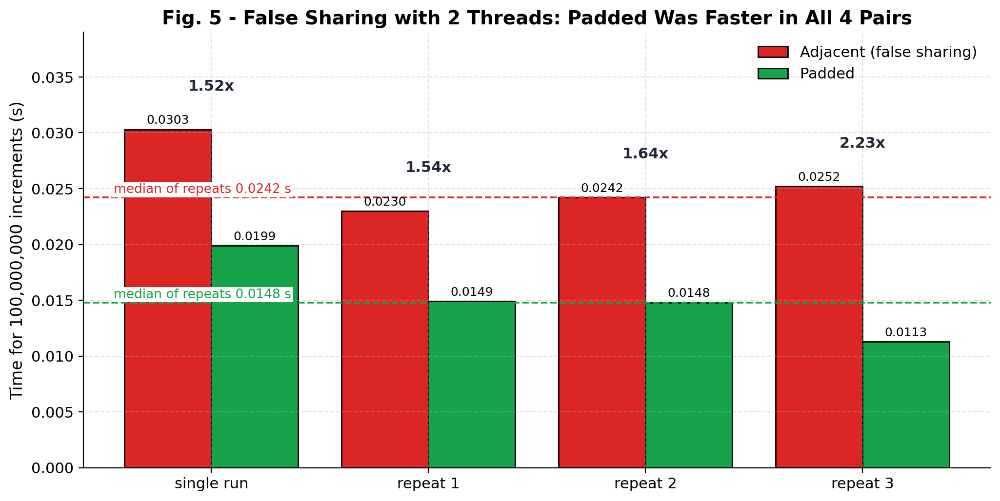</p>

**What the graph shows:** in all four pairs the padded layout was faster, by **1.52×, 1.54×, 1.64× and 2.23×**. The medians of the three repeats were **0.0242 s** vs **0.0148 s**. The direction agrees with the simulation, and both layouts gave the correct total of 100,000,000.

### 12.6 The 1-thread control

<p align="center">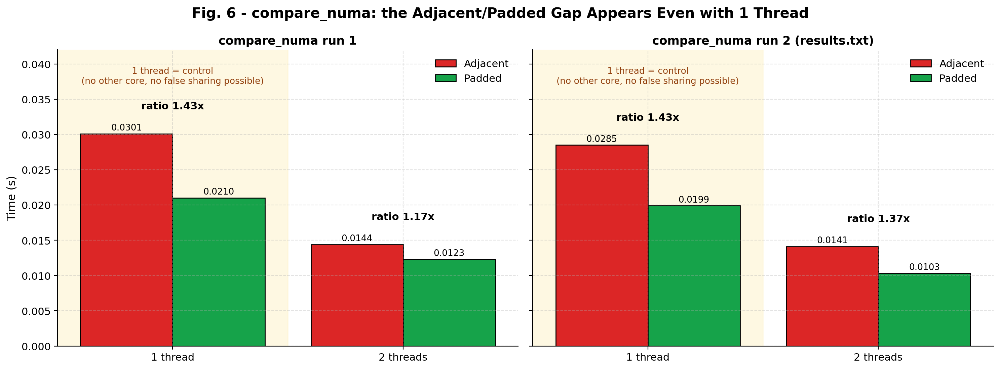</p>

**What the graph shows:**
- With **1 thread**, false sharing is impossible: there is no second core. The two layouts also do exactly the same work (one counter, `cnt[0]`). Yet "adjacent" was **1.43× slower** in both runs.
- With **2 threads**, the gap was **smaller**: 1.17× and 1.37×.
- In every pair the **adjacent run comes first**, so the most likely cause of the 1-thread gap is a **warm-up effect**: the first measurement in a pair runs while the virtual CPU is still ramping up its clock and loading code and data. The same effect explains why the **very first** 2-thread sweep after compiling (0.0584 s) was slower than the 1-thread sweep.
- The adjacent layout also **sped up by about 2×** from 1 to 2 threads (0.0285 → 0.0141 s). Strong false sharing would have stopped it from scaling at all.
- **Honest conclusion:** on this 2-vCPU VM the false-sharing penalty was **small**, probably **below the measured 1.64×**. The textbook effect, often several times slower, was not clearly reproduced. Likely reasons:
  - the runs are very short (10–30 ms), so start-up and warm-up effects are a large part of each time;
  - VMware may not run both virtual CPUs at exactly the same moment, and the i5-13400 host mixes fast (P) and efficient (E) cores;
  - the core's store buffer can absorb part of the delay while the line is away.

  Section 17 lists how to measure it more cleanly.

### 12.7 Memory sweep

<p align="center">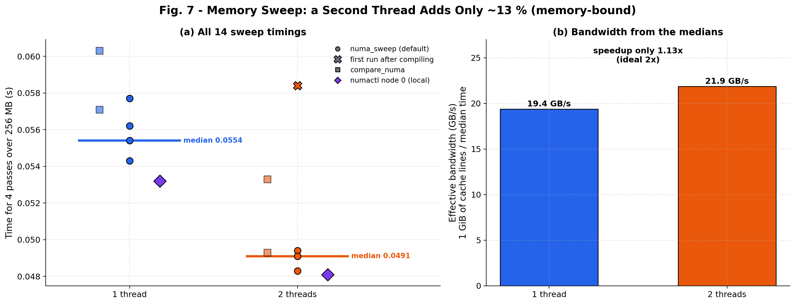</p>

**What the graph shows:**
- **(a)** All 14 timings. The 2-thread runs are clearly faster except one: the **first run after compiling** (×, 0.0584 s), a warm-up outlier. The **numactl node-0 (local) runs** (purple diamonds) fall inside, or just below, the spread of the default runs. They are single runs, so the small difference is noise.
- **(b)** A second thread raised the bandwidth only from **19.4 to 21.9 GB/s (1.13×)**. The loop does almost no arithmetic per byte. One core can already request lines nearly as fast as the memory system (and the VM) can deliver them, so the second core mostly waits for memory too. This is typical of **memory-bound** code.

### 12.8 NUMA topology

<p align="center">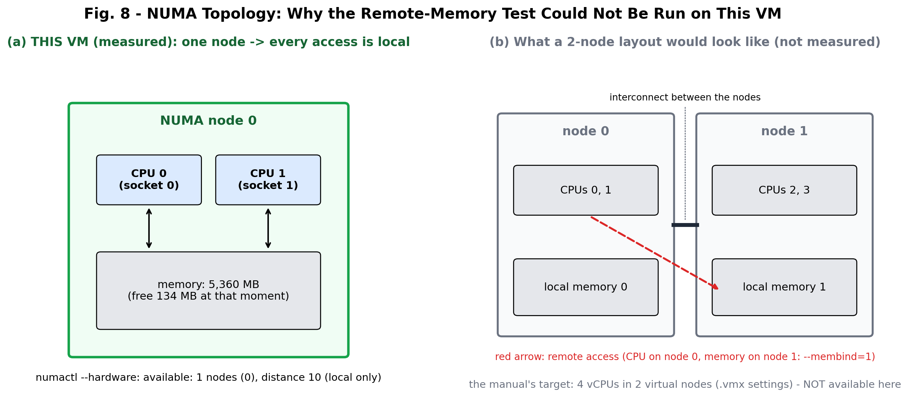</p>

**What the figure shows:** **(a)** the measured topology: **one node** containing both vCPUs and all 5,360 MB, so every access is local and `--cpunodebind=0 --membind=0` is the same as the default placement. **(b)** The two-node layout the manual aims for, with a real remote path. It was **not available** on this VM, because Step 5.4 (the `.vmx` NUMA settings) did not produce a second node. Even when it does, both virtual nodes on one desktop CPU share the same physical memory, so a real remote penalty needs a **multi-socket machine**.

### 12.9 Summary dashboard

<p align="center">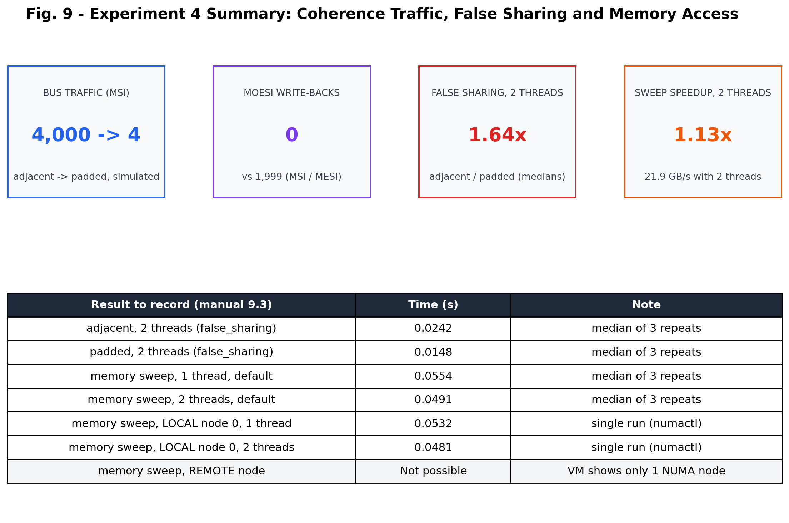</p>

---

## 13. Comparison of Protocols, Layouts and Placement

The manual's observation table (Section 10), filled in with **this experiment's results**:

| Case | Correctness | Relative performance (this experiment) | Scalability |
|:--|:--|:--|:--|
| **MSI** (simulated) | ✅ Correct | Most bus traffic: 4,000 (adjacent), 4 (padded); even private lines need an upgrade | Same ping-pong as MESI when lines are shared |
| **MESI** (simulated) | ✅ Correct | 3,999 / 2: silent E→M saves the upgrade for private data | Good for private data; same ping-pong on shared lines |
| **MOESI** (simulated) | ✅ Correct | 3,999 / 2, and **0 write-backs** (1,999 cache-to-cache instead) | Lowest **memory** traffic of the three |
| **Adjacent counters** | ✅ Correct (100,000,000) | Slower: median 0.0242 s with 2 threads | Still sped up about 2× from 1 to 2 threads in compare_numa; the penalty was small on this VM |
| **Padded counters** | ✅ Correct (100,000,000) | Fastest: median 0.0148 s with 2 threads | Good: 1.7× and 1.9× from 1 to 2 threads (compare_numa runs 1 and 2) |
| **Local memory** (`--membind=0`) | ✅ Correct (sum 16,777,216) | 0.0532 s (1 thread), 0.0481 s (2 threads) | 1.13× from 1 to 2 threads (memory-bound) |
| **Remote memory** (`--membind=1`) | — | **Not measurable**: only 1 NUMA node | — |

---

## 14. Observations and Limitations

**Observations:**

1. **All protocols and all layouts were correct.** Coherence guarantees correctness; the question is only how much traffic it takes.
2. **Coherence works per cache line.** Two unrelated counters in one 64-byte line made every protocol generate about **4,000 bus transactions** in the simulation; padding reduced this to **2–4**.
3. **MESI** helps private data (silent writes), and **MOESI** avoids write-backs to memory. Neither helps against false sharing, which only a **layout change** fixes.
4. On the real VM, **padded was faster in every 2-thread pair** (median ratio 1.64×), but a **1-thread control** showed that part of this gap is a **warm-up / run-order effect**.
5. The **memory sweep is memory-bound**: a second thread added only 13 %.
6. The VM had **one NUMA node**, so local and remote memory could not be compared.

**Limitations:**

| Limitation | Effect |
|:--|:--|
| **1 NUMA node** (manual Step 5.4 not effective) | No remote / local ratio; the `numactl` runs only show that binding to node 0 changes nothing here |
| **2 vCPUs** (manual: 4) | No 4-thread runs; `compare_numa` was cut down to 1 and 2 threads |
| Very **short runs** (10–60 ms) | Warm-up and start-up effects are a large share of each time |
| **Adjacent always ran before padded** | Run-order bias; the 1-thread control shows it is about 1.4× here |
| Few repetitions (3 repeats + 1–2 extra runs) | Medians are used, but the spread is wide (padded: 0.0113–0.0199 s) |
| The `numactl` runs were done once each | Their small differences from the default runs are within noise |
| Hybrid host CPU (P- and E-cores) under VMware | Which physical core runs each vCPU is not controlled |
| The simulator counts **events**, not time | Shows *how much* traffic each protocol makes, not its cost in nanoseconds |

---

## 15. Troubleshooting and Issues Encountered

### 15.1 Things seen during this experiment

No program failed. These outputs need explaining:

| What was seen | Screenshot | Explanation |
|:--|:-:|:--|
| `numactl --hardware` shows `available: 1 nodes (0)` | 03 | The VM exposes 2 sockets but 1 NUMA node. Remote memory (`--membind=1`) would fail with an invalid-node error, so it was not run |
| `node 0 free: 134 MB` while `free -h` shows 2.6 GiB available | 01, 03 | `numactl` counts truly free pages; `free` also counts page cache that Linux can release. The 256 MB buffer was allocated without problems |
| The first 2-thread sweep (0.0584 s) was slower than the 1-thread sweep (0.0562 s) | 04 | First run after compiling: a warm-up effect. The later 2-thread runs were all faster (0.048–0.049 s) |
| In the repeated batches, all four commands were printed first and the results came afterwards | 05, 06 | The four commands were pasted together; the shell echoed them, then ran them in order. This is normal |
| "Adjacent" slower than "Padded" even with 1 thread | 05, 06 | Run-order / warm-up effect (Section 12.6) |

### 15.2 General troubleshooting guide

| Problem | Solution |
|:--|:--|
| `numactl: command not found` | `sudo apt install numactl hwloc -y` |
| Only one NUMA node in the VM | Power the VM off and add to the `.vmx` file: `numvcpus = "4"`, `cpuid.coresPerSocket = "2"`, `numa.vcpu.min = "2"`, `numa.vcpu.maxPerVirtualNode = "2"`. If it still shows one node, use a multi-socket machine for the NUMA part |
| `libnuma: Warning: node argument 1 is out of range` | That node does not exist; check `numactl --hardware` |
| `implicit declaration of function 'aligned_alloc'` | Compile on Linux (glibc provides it); some Windows compilers (MinGW) do not have `aligned_alloc` |
| Both layouts give the same time | Make sure the program was compiled with `-O2` **and** that `volatile` is still there; use 2 or more threads |
| Times vary a lot between runs | Close other programs, run each case several times, discard the first run, and keep the median |

---

## 16. Important Terms

| Term | Meaning |
|:--|:--|
| **Cache line** | The block of memory (64 bytes) that caches copy and track as one unit |
| **Cache coherence** | Hardware rules that keep all cores' cached copies of a location consistent |
| **Snooping** | Each cache watches the shared bus and reacts to the other caches' requests |
| **MSI / MESI / MOESI** | Coherence protocols named after their line states (Modified, Owned, Exclusive, Shared, Invalid) |
| **BusRd / BusRdX / BusUpgr** | Read miss / write miss (read-for-ownership) / upgrade of a Shared line before writing |
| **Invalidation** | Throwing away another cache's copy of a line |
| **Write-back** | Writing a dirty line to main memory |
| **Cache-to-cache transfer** | Sending a line directly from one cache to another |
| **False sharing** | Threads writing different variables in the same cache line, causing the line to bounce between cores |
| **Padding** | Adding unused space so each thread's data sits on its own cache line |
| **Ping-pong** | A cache line moving back and forth between cores |
| **NUMA** | Memory split into nodes; local memory is faster than remote memory |
| **First-touch policy** | Linux places a memory page on the node of the thread that first writes it |
| **numactl** | Tool to show NUMA nodes and bind threads (`--cpunodebind`) and memory (`--membind`) to a node |
| **Memory-bound** | Speed limited by how fast data can be moved, not by computation |
| **Warm-up effect** | The first measurement is slower because clocks, caches and code are not yet "warm" |

---

## 17. Conclusion

This experiment studied cache coherence and memory placement with one simple example: two threads, each incrementing its own counter.

- **Protocols (simulated):** all three protocols keep the caches correct, and they differ in traffic.
  - **MESI** saves the upgrade for data used by one core (silent E→M).
  - **MOESI** removes all **1,999 write-backs to memory** by passing dirty lines cache to cache.
  - With the counters on one line, every protocol needed **about 4,000 bus transactions and 1,999 invalidations**; padding them onto separate lines reduced this to **2–4 transactions and 0 invalidations**. **Data layout matters more than the choice of protocol.**
- **False sharing (measured):** both layouts always gave the correct total, and the padded layout was faster in every 2-thread pair (median **0.0148 s vs 0.0242 s**, 1.64×). However, a 1-thread control showed a 1.43× gap where false sharing is impossible. On this 2-vCPU VM the real false-sharing cost was therefore **small**, and part of the measured ratio is a warm-up effect.
- **Memory sweep / NUMA (measured):** the sweep is **memory-bound**, with 2 threads giving only **1.13×** (19.4 → 21.9 GB/s). The VM exposed only **one NUMA node**, so binding to node 0 changed nothing, and the **remote-memory test could not be performed**.

**Key lesson:** coherence is handled by hardware, but its **cost depends on how data is laid out**. Keep data written by different threads on **different cache lines**, and keep threads and their memory on the **same NUMA node**. On real multi-socket hardware, both effects become much larger than on this small VM.

**Future work** (to measure the effects more cleanly):
1. Enable two virtual NUMA nodes (`.vmx` settings, manual Step 5.4) or use a multi-socket server, then run `--membind=1` to get the **remote / local** ratio.
2. Use **4 vCPUs** and run 1, 2 and 4 threads, as in the manual's `compare_numa.c`.
3. Make the runs longer (e.g. `N = 1,000,000,000`), **alternate** the adjacent/padded order, discard the first run, and repeat 10 times.
4. Pin the threads to different cores (`taskset -c 0,1` or `OMP_PROC_BIND=spread`) and measure the line transfers directly with `perf c2c`.

---

## 18. Repository Structure and Reproduction

```text
Experiment_4/
├── README.md                              ← this report
├── screenshots/                           ← 6 screenshots, renamed in execution order
│   ├── 01_system_info_ubuntu_nproc_memory_disk.png
│   ├── 02_toolchain_gcc_python_numactl_openmp.png
│   ├── 03_numactl_hardware_and_lscpu.png
│   ├── 04_coherence_sim_false_sharing_numa_sweep.png
│   ├── 05_compare_numa_run1_and_repeated_runs.png
│   └── 06_repeated_runs_and_compare_numa_results_txt.png
├── src/
│   ├── coherence_sim.py                   ← Part A: MSI / MESI / MOESI simulator
│   ├── false_sharing.c                    ← Part B1: adjacent vs padded counters
│   ├── numa_sweep.c                       ← Part B2: memory sweep (run under numactl)
│   └── compare_numa.c                     ← Part C: both tests, 1 and 2 threads
├── results/
│   ├── raw/
│   │   ├── 01_system_info.txt             ← lsb_release, nproc, free, df, versions, numactl, lscpu
│   │   ├── 02_coherence_sim_output.txt
│   │   ├── 03_false_sharing_and_numa_sweep_runs.txt
│   │   ├── 04_compare_numa_run1.txt
│   │   └── compare_numa_results.txt       ← results.txt saved on the VM (tee)
│   ├── system_info.csv
│   ├── coherence_sim_results.csv          ← event counts, 6 layout/protocol cases
│   ├── coherence_state_trace.csv          ← line-A states, 8 steps (manual 9.1, checked against the simulator)
│   ├── false_sharing_runs.csv             ← every adjacent / padded timing
│   ├── memory_sweep_runs.csv              ← every sweep timing (default and numactl)
│   └── summary_metrics.csv                ← medians, ratios, bandwidth (written by the script)
├── scripts/
│   ├── run_all.sh                         ← runs every part in the lab's order
│   └── generate_graphs.py                 ← matplotlib graph generator
└── graphs/                                ← 9 generated figures
```

**Quick reproduction (Ubuntu):**

```bash
sudo apt install build-essential numactl hwloc python3 -y
bash scripts/run_all.sh                     # everything, in the lab's order

# or part by part
python3 src/coherence_sim.py 1000
gcc -O2 src/false_sharing.c -fopenmp -o false_sharing
OMP_NUM_THREADS=2 ./false_sharing adjacent
OMP_NUM_THREADS=2 ./false_sharing padded
gcc -O2 src/numa_sweep.c -fopenmp -o numa_sweep
OMP_NUM_THREADS=2 numactl --cpunodebind=0 --membind=0 ./numa_sweep 256
OMP_NUM_THREADS=2 numactl --cpunodebind=0 --membind=1 ./numa_sweep 256   # needs 2 NUMA nodes
gcc -O2 src/compare_numa.c -fopenmp -o compare_numa && ./compare_numa

# Regenerate graphs
pip install matplotlib pandas numpy
python scripts/generate_graphs.py
```

---

## 19. References

1. D. J. Sorin, M. D. Hill and D. A. Wood, *A Primer on Memory Consistency and Cache Coherence*, 2nd ed., Morgan & Claypool, 2020.
2. J. L. Hennessy and D. A. Patterson, *Computer Architecture: A Quantitative Approach*, 6th ed., Morgan Kaufmann, 2017 (Chapter 5: Thread-Level Parallelism, snooping protocols).
3. M. S. Papamarcos and J. H. Patel, "A low-overhead coherence solution for multiprocessors with private cache memories," *ISCA*, 1984 (the MESI / Illinois protocol).
4. AMD, *AMD64 Architecture Programmer's Manual, Volume 2: System Programming* (MOESI cache states).
5. U. Drepper, *What Every Programmer Should Know About Memory*, Red Hat, 2007 (cache lines, false sharing, NUMA).
6. A. Kleen, *numactl(8)* and *libnuma* manual pages.
7. OpenMP Architecture Review Board, *OpenMP Application Programming Interface Specification*, Version 5.2, 2021.
8. VMware (Broadcom), *Virtual NUMA* documentation (`numa.vcpu.*` advanced settings).
9. *Experiment: Analyze Cache Coherence (MSI, MESI, MOESI) and NUMA Memory Access Performance*, Lab Manual, PGC Laboratory.

---

<div align="center"><sub>Experiment 4 · Parallel Computing and GPU Programming Laboratory</sub></div>
