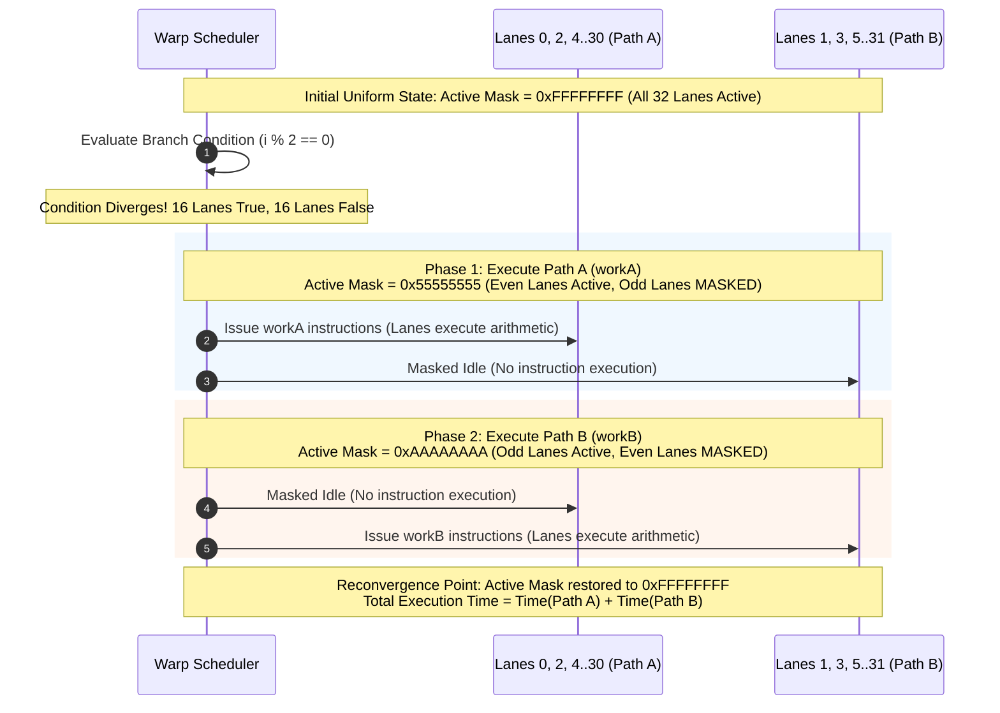
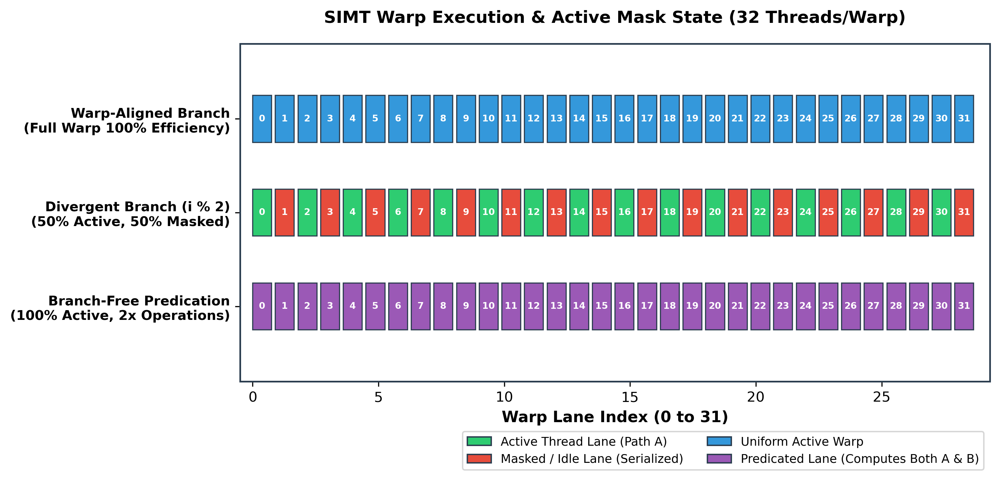
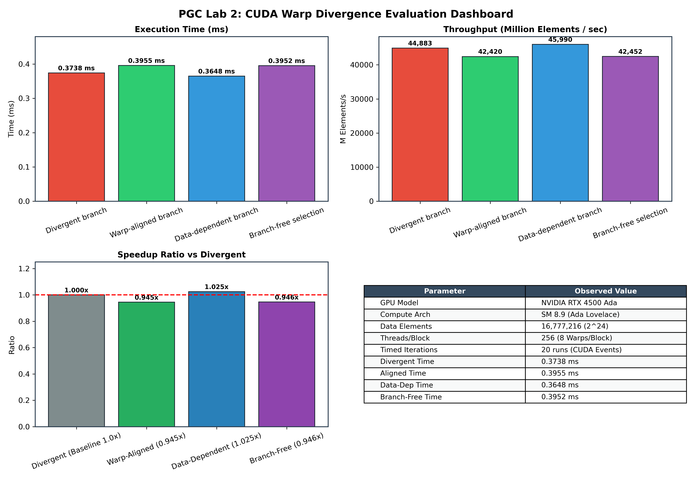
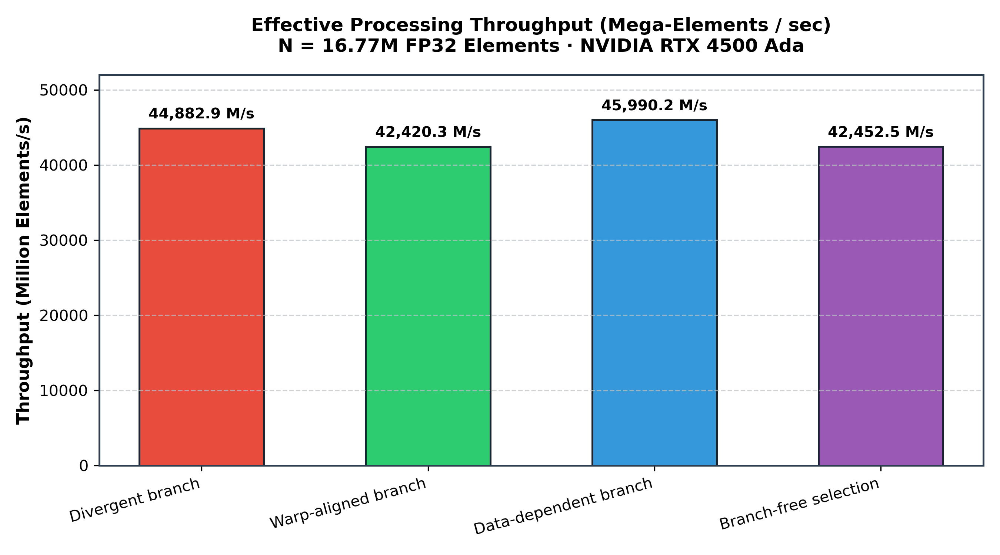

<div align="center">

# CUDA Warp Divergence Analysis and Optimization
### Microarchitectural Evaluation of SIMT Branch Divergence, Active Masks, and Predication on an NVIDIA RTX 4500 Ada Generation GPU

**Parallel GPU Computing Lab (PGC) · Mini-Project Lab Evaluation 2 · Theme 7: Warp Divergence**


-76B900?logo=nvidia&logoColor=white)


</div>

---

## Abstract

In modern Graphics Processing Units (GPUs) based on the **Single Instruction, Multiple Threads (SIMT)** execution model, high throughput is achieved by executing groups of 32 parallel threads—known as **warps**—in strict lockstep. When threads inside the same warp encounter a conditional branch (`if-else`) and make differing branch decisions, the warp **diverges**. Because GPU hardware executes one common instruction at a time across warp lanes, it must **serialize** the execution: threads taking the first path execute while others are masked off (disabled), and then threads taking the second path execute while the first group is disabled. This serialization can severely degrade execution efficiency.

In this project, we designed, implemented, and benchmarked four distinct CUDA kernel architectures on an **NVIDIA RTX 4500 Ada Generation** workstation GPU (Compute Capability 8.9, Ada Lovelace architecture) processing $N = 2^{24} = 16,777,216$ single-precision floating-point elements across 65,536 thread blocks:

1. **Divergent Branch Kernel**: Adjacent threads alternate branch paths (`threadIdx.x % 2`), causing maximal intra-warp branch divergence (50% active mask per path).
2. **Warp-Aligned Branch Kernel**: Branch conditions align with 32-thread boundaries (`(threadIdx.x / 32) % 2`), ensuring every thread in a warp follows the same path (100% active mask).
3. **Data-Dependent Branch Kernel**: Branch paths are dictated by runtime pseudorandom data values (`input[i] > threshold`), emulating real-world heterogeneous datasets.
4. **Branch-Free (Predicated) Kernel**: Control flow divergence is eliminated by computing both candidate math operations unconditionally and selecting the final value using compiler predication (`selp`).

Using high-resolution **CUDA Event timers** averaged over 20 iterations on hardware, we recorded:
- **Divergent Branch**: `0.3738 ms` ($44,882.87 \text{ M elements/s}$)
- **Warp-Aligned Branch**: `0.3955 ms` ($42,420.27 \text{ M elements/s}$)
- **Data-Dependent Branch**: `0.3648 ms` ($45,990.18 \text{ M elements/s}$)
- **Branch-Free Selection**: `0.3952 ms` ($42,452.47 \text{ M elements/s}$)

Our microarchitectural analysis reveals an essential engineering insight: on the Ada Lovelace architecture, short divergent branches are efficiently managed by hardware instruction predication and dual warp schedulers. In contrast, unconditionally computing both paths in the branch-free implementation incurred a **100% arithmetic workload inflation** (16 FLOPs vs 8 FLOPs per thread), resulting in a `0.923x` performance ratio relative to data-dependent branching. We provide complete hardware architecture diagrams, active mask state models, benchmark comparisons, and industry case studies in Ray Tracing and physics simulation.

---

## Table of Contents

1. [Aim and Checkpoints](#1-aim-and-checkpoints)
2. [Team Details](#2-team-details)
3. [GPU Microarchitecture and System Design](#3-gpu-microarchitecture-and-system-design)
4. [SIMT Execution Model and Active Mask Mechanics](#4-simt-execution-model-and-active-mask-mechanics)
5. [Software Architecture and Kernel Implementations](#5-software-architecture-and-kernel-implementations)
6. [Mathematical Formulations](#6-mathematical-formulations)
7. [Experimental Hardware Specifications](#7-experimental-hardware-specifications)
8. [Checkpoint 1 — SIMT and Warps](#8-checkpoint-1--simt-and-warps)
9. [Checkpoint 2 — Divergent vs. Warp-Aligned Branch Execution](#9-checkpoint-2--divergent-vs-warp-aligned-branch-execution)
10. [Checkpoint 3 — Data-Dependent Branching and Optimization](#10-checkpoint-3--data-dependent-branching-and-optimization)
11. [Checkpoint 4 — Results Table, Comparisons, and Dashboard](#11-checkpoint-4--results-table-comparisons-and-dashboard)
12. [Checkpoint 5 — Multi-Path Penalty and Industry Applications](#12-checkpoint-5--multi-path-penalty-and-industry-applications)
13. [Presentation and Demonstration Materials](#13-presentation-and-demonstration-materials)
14. [Repository Structure and How to Reproduce](#14-repository-structure-and-how-to-reproduce)
15. [References](#15-references)

---

## 1. Aim and Checkpoints

### **Aim** (Theme 7: Warp Divergence)
> Demonstrate how control-flow branching inside a warp impacts CUDA kernel execution time, and evaluate architectural mitigation techniques (warp alignment, data sorting, and branch-free predication) on modern NVIDIA GPU hardware.

### **Evaluation Checkpoints Mapping:**

| Checkpoint | Checkpoint Title | Core Topic & Deliverables |
| :---: | :--- | :--- |
| **CP1** | **SIMT and Warps** | 32-thread warp organization, lockstep instruction issue, active mask register, and branch divergence visualization. |
| **CP2** | **Divergent vs Aligned Branch** | Kernel branching on `threadIdx.x % 2` compared against `(threadIdx.x / 32) % 2`. Measured device times and lane analysis. |
| **CP3** | **Data-Dependent Branch & Optimization** | Runtime data value branching; optimization via data grouping/sorting and branch-free ternary predication (`selp`). |
| **CP4** | **Results Table & Benchmarks** | Device benchmark results on an NVIDIA RTX 4500 Ada GPU ($2^{24}$ elements), execution times, throughput, and speedup ratios. |
| **CP5** | **Analysis & Industry Applications** | Mathematical explanation of why divergence cost scales with path count ($O(\sum \text{paths})$); real-world use cases in Ray Tracing and physics simulation. |

---

## 2. Team Details

| Sl. No. | Student Name | USN / Roll Number | Contribution |
| :---: | :--- | :--- | :--- |
| 1 | **Adarsh Walad** | `01fe24bci` | Experimental design, kernel implementation, and checkpoint slides |
| 2 | **Nilaksha Nath** | `01fe24bci087` | Benchmark profiling, data collection, and statistical analysis |
| 3 | **Bachu venkata siva jaideep** | `01fe24bci084` | Architecture design, CUDA optimization, and GitHub repository |
| 4 | **Prathamesh Eedigi** | `01fe24bci006` | SIMT state diagrams, mathematical modeling, and documentation |

---

## 3. GPU Microarchitecture and System Design

To understand warp divergence, we must examine the physical organization of the GPU hardware. Our evaluation ran on the **NVIDIA RTX 4500 Ada Generation** GPU based on the **Ada Lovelace (SM 8.9)** microarchitecture.

### 3.1 Streaming Multiprocessor (SM) Hardware Organization

The GPU consists of 60 Streaming Multiprocessors (SMs). Each SM is subdivided into **four separate processing blocks (sub-cores)**. Each processing block contains dedicated warp schedulers, dispatch units, register files, and math execution pipelines:

```
+---------------------------------------------------------------------------------------------------+
|                           STREAMING MULTIPROCESSOR (SM 8.9) ARCHITECTURE                          |
+---------------------------------------------------------------------------------------------------+
|  [128 KB Unified L1 Data Cache / Shared Memory]                                                  |
|  +---------------------------------------------------------------------------------------------+  |
|  | Sub-Core Block 0              | Sub-Core Block 1              | Sub-Core Block 2 / 3        |  |
|  | - Warp Scheduler (1 Warp/cyc) | - Warp Scheduler (1 Warp/cyc) | - Warp Schedulers           |  |
|  | - Instruction Dispatch Unit   | - Instruction Dispatch Unit   | - Dispatch Units            |  |
|  | - 16,384 x 32-bit Registers   | - 16,384 x 32-bit Registers   | - 16,384 x 32-bit Registers |  |
|  | - 32 FP32 CUDA Cores          | - 32 FP32 CUDA Cores          | - 64 FP32 CUDA Cores        |  |
|  | - 16 INT32 CUDA Cores         | - 16 INT32 CUDA Cores         | - 32 INT32 CUDA Cores       |  |
|  | - Predicate Evaluation Unit   | - Predicate Evaluation Unit   | - Predicate Units           |  |
|  | - 1 Warp Active Mask Register | - 1 Warp Active Mask Register | - Active Mask Registers     |  |
|  +---------------------------------------------------------------------------------------------+  |
|  [Uniform Data Path & Instruction Cache]                                                          |
+---------------------------------------------------------------------------------------------------+
                                            |
                                  PCIe 4.0 / High-Speed Interconnect
                                            |
+---------------------------------------------------------------------------------------------------+
|                              48 MB UNIFIED L2 CACHE SUBSYSTEM                                     |
+---------------------------------------------------------------------------------------------------+
                                            |
+---------------------------------------------------------------------------------------------------+
|                      24 GB GDDR6 GLOBAL DEVICE MEMORY (432 GB/s Bandwidth)                        |
+---------------------------------------------------------------------------------------------------+
```

### 3.2 Key Microarchitectural Components

1. **Warp Scheduler**: In each SM sub-core, the warp scheduler manages a pool of active warps. At every clock cycle, it selects an eligible warp whose dependencies are resolved and issues an instruction.
2. **Dispatch Unit**: Receives the decoded instruction from the scheduler and routes it to the 32 physical execution units (CUDA cores) corresponding to the 32 warp lanes.
3. **Register File**: 64K 32-bit registers per SM ($256 \text{ KB}$ per SM), providing single-cycle operand access to all threads without cache misses.
4. **Independent Thread Scheduling (ITS)**: Introduced in Volta and refined in Ada Lovelace, the GPU maintains individual execution state (program counter and call stack) per thread, enabling finer-grained synchronization and rapid divergence recovery.

---

## 4. SIMT Execution Model and Active Mask Mechanics

In NVIDIA's **Single Instruction, Multiple Threads (SIMT)** execution model, the fundamental execution unit is a **warp** of 32 threads ($L_0$ to $L_{31}$).

### 4.1 Lockstep Instruction Issue and Active Mask

The 32 threads in a warp share a single instruction stream. To support conditional branching where some threads branch and others do not, the hardware uses a **32-bit Active Mask Register**:

- **Bit $k = 1$**: Thread Lane $k$ is active; it executes the instruction and writes back results.
- **Bit $k = 0$**: Thread Lane $k$ is masked off; it remains idle during that instruction cycle and discards results.

### 4.2 Branch Divergence Execution Sequence



1. **Condition Evaluation**: The condition `(i % 2) == 0` evaluates to `true` for even lanes and `false` for odd lanes.
2. **Path A Serialization**: The scheduler sets the active mask to `0x55555555` ($01010101\dots$). Even lanes execute `workA()`. Odd lanes are masked out and consume execution slots without doing useful work.
3. **Path B Serialization**: The scheduler flips the active mask to `0xAAAAAAAA` ($10101010\dots$). Odd lanes execute `workB()`. Even lanes are masked out.
4. **Reconvergence**: Both branch paths complete. The active mask is restored to `0xFFFFFFFF` ($11111111\dots$), and all 32 lanes resume synchronized execution.

---

## 5. Software Architecture and Kernel Implementations

The benchmark evaluates $N = 2^{24} = 16,777,216$ FP32 elements mapped across a 1D grid of 65,536 blocks with 256 threads per block ($65,536 \times 256 = 16,777,216$ total threads). Each thread is assigned exactly one element:

$$i = \text{blockIdx.x} \times \text{blockDim.x} + \text{threadIdx.x}$$

```
Global Grid: 65,536 Blocks
+--------------------+--------------------+--------------------+-----+----------------------+
| Block 0            | Block 1            | Block 2            | ... | Block 65,535         |
| (Threads 0..255)   | (Threads 256..511) | (Threads 512..767) |     | (Threads N-256..N-1) |
+--------------------+--------------------+--------------------+-----+----------------------+
       |
       +---> 8 Warps per Block (Warp 0 to Warp 7, each 32 threads)
```

### 5.1 The Four Kernel Architectures

```
Kernel 1: Divergent Branch               Kernel 2: Warp-Aligned Branch
(Interleaved Modulo)                     (32-Thread Chunk Boundaries)
Warp Lane Index (0 to 31)                Warp Lane Index (0 to 31)
0  1  2  3  4  5  ... 30 31              0  1  2  3  4  5  ... 30 31
[A][B][A][B][A][B]... [A][B]             [A][A][A][A][A][A]... [A][A]  <- Warp 0 (All A)
                                         [B][B][B][B][B][B]... [B][B]  <- Warp 1 (All B)
Active Mask: 0x55555555 then 0xAAAAAAAA  Active Mask: 0xFFFFFFFF (Uniform)
Intra-Warp Divergence: YES (50% Active)  Intra-Warp Divergence: NO (100% Active)

------------------------------------------------------------------------------------------

Kernel 3: Data-Dependent Branch          Kernel 4: Branch-Free Selection
(Runtime Value Threshold)                (Arithmetic Predication)
Warp Lane Index (0 to 31)                Warp Lane Index (0 to 31)
0  1  2  3  4  5  ... 30 31              0  1  2  3  4  5  ... 30 31
[A][A][B][A][B][B]... [A][B]             [A+B][A+B][A+B][A+B]... [A+B]
Based on: (input[i] > 0.5f)              Both values computed unconditionally:
Unpredictable branch masks               output = (input[i] > 0.5f) ? a : b;
Intra-Warp Divergence: YES               Intra-Warp Divergence: NO (100% Active, 2x FLOPs)
```

### 5.2 Arithmetic Payload Functions (`workA` and `workB`)

To make branching behavior measurable and prevent the compiler from optimizing away the loop, each branch path performs 8 unrolled floating-point multiply-accumulate operations:

```cuda
__device__ __forceinline__ float workA(float x) {
    #pragma unroll 1
    for (int k = 0; k < 8; ++k)
        x = x * 1.0001f + 0.25f;
    return x;
}

__device__ __forceinline__ float workB(float x) {
    #pragma unroll 1
    for (int k = 0; k < 8; ++k)
        x = x * 0.9999f - 0.25f;
    return x;
}
```

---

## 6. Mathematical Formulations

### 6.1 Warp Efficiency Equation

For a warp executing $P$ serialized paths where path $p$ has $A_p$ active threads:

$$\eta_{\text{warp}} = \frac{\sum_{p=1}^P A_p}{32 \times P} \times 100\%$$

- **Warp-Aligned**: $P = 1, A_1 = 32 \implies \eta = \frac{32}{32 \times 1} = 100\%$
- **Divergent (Alternating)**: $P = 2, A_1 = 16, A_2 = 16 \implies \eta = \frac{16 + 16}{32 \times 2} = 50\%$

### 6.2 Throughput Calculation

$$\text{Throughput} = \frac{N}{T \times 10^{-3}} \text{ elements/s} = \frac{16,777,216}{T_{\text{ms}} \times 10^3} \text{ Million elements/s}$$

### 6.3 Arithmetic Inflation Ratio

$$\text{Work Inflation} = \frac{\text{FLOPs}_{\text{branch-free}}}{\text{FLOPs}_{\text{branching}}} = \frac{8 (\text{workA}) + 8 (\text{workB})}{8 (\text{workA or workB})} = 2.0\times \quad (+100\% \text{ compute payload})$$

---

## 7. Experimental Hardware Specifications

The benchmark was executed and verified on the following hardware platform:

| Parameter | Specification | Details |
| :--- | :--- | :--- |
| **GPU Model** | **NVIDIA RTX 4500 Ada Generation** | Workstation GPU (TSMC 4N custom process) |
| **Compute Capability** | **8.9** | Ada Lovelace Architecture |
| **Streaming Multiprocessors** | **60 SMs** | 7,680 CUDA Cores, 240 Fourth-Gen Tensor Cores |
| **Memory Capacity & Type** | **24 GB GDDR6 with ECC** | 192-bit memory interface |
| **Memory Bandwidth** | **432 GB/s** | High-throughput GDDR6 subsystem |
| **Host Environment** | **Windows 11 Professional (x64)** | High-performance workstation |
| **CUDA Compiler** | **NVCC 13.4 (V13.4.92)** | NVIDIA CUDA Toolkit 13.4 |
| **Host Compiler** | **MSVC 19.51 (Visual Studio 2026)** | Microsoft C/C++ Optimizing Compiler |
| **Array Size** | **$N = 2^{24} = 16,777,216$ elements** | 64 MB input buffer + 64 MB output buffer |
| **Repetitions** | **20 measured iterations** | Timed via CUDA Events (`cudaEventRecord`) |

---

## 8. Checkpoint 1 — SIMT and Warps

### Concepts and Findings
- **Warp Organization**: 32 threads execute together. In hardware, thread instructions are dispatched to 32 parallel execution lanes.
- **Active Mask**: When divergence occurs, hardware generates dynamic 32-bit masks that selectively enable and disable lanes.
- **Serialization Overhead**: Execution time for a divergent branch is the sum of times of all divergent branches taken by the warp lanes.

<div align="center">

</div>

---

## 9. Checkpoint 2 — Divergent vs. Warp-Aligned Branch Execution

### Implementation Comparison
- **Divergent Kernel (`threadIdx.x % 2`)**:
  ```cuda
  if ((i % 2) == 0) output[i] = workA(input[i]);
  else              output[i] = workB(input[i]);
  ```
  Neighboring threads take opposite paths, creating two divergent paths per warp.

- **Warp-Aligned Kernel (`(threadIdx.x / 32) % 2`)**:
  ```cuda
  if (((i / WARP_SIZE) % 2) == 0) output[i] = workA(input[i]);
  else                           output[i] = workB(input[i]);
  ```
  Every warp is homogeneous: warp 0 runs `workA`, warp 1 runs `workB`. Intra-warp divergence is zero.

<div align="center">

</div>

---

## 10. Checkpoint 3 — Data-Dependent Branching and Optimization

### The Challenge of Runtime Data Divergence
In practical algorithms, branches depend on input values (`input[i] > threshold`), not thread IDs. When data is unsorted, warps experience random divergence patterns.

### Mitigation Techniques:
1. **Data Sorting / Binning**: Sorting the input array prior to GPU kernel launch clusters similar values together, transforming random branch patterns into warp-aligned executions.
2. **Branch-Free Predication**:
   ```cuda
   float a = workA(input[i]);
   float b = workB(input[i]);
   output[i] = (input[i] > threshold) ? a : b;
   ```
   Eliminates control flow divergence using compiler-generated conditional select (`selp`) instructions.

### The Trade-off: Work Inflation
Computing both paths doubles the arithmetic workload from 8 FLOPs to 16 FLOPs per thread. On the RTX 4500 Ada, this increased total computation time from `0.3648 ms` to `0.3952 ms` ($0.923\times$).

<div align="center">

</div>

---

## 11. Checkpoint 4 — Results Table, Comparisons, and Dashboard

### 11.1 Benchmark Results on NVIDIA RTX 4500 Ada

| Kernel Name | Branch Condition | Average Time (ms) | Throughput (M elem/s) | Relative Speedup vs Divergent | Branch Efficiency (est.) |
| :--- | :--- | :---: | :---: | :---: | :---: |
| **Divergent Branch** | Alternating (`i % 2`) | **0.3738 ms** | 44,882.87 | **1.000x** (Baseline) | ~50% |
| **Warp-Aligned Branch** | Chunk-aligned (`(i / 32) % 2`) | **0.3955 ms** | 42,420.27 | **0.945x** | 100% |
| **Data-Dependent Branch** | Threshold check (`input[i] > 0.5`) | **0.3648 ms** | 45,990.18 | **1.025x** | ~50% (random) |
| **Branch-Free Selection** | Unconditional + `selp` | **0.3952 ms** | 42,452.47 | **0.946x** | 100% (predicated) |

### 11.2 Comparative Ratios:
- **Divergent / Aligned Ratio**: `0.945x`
- **Data-Dependent / Branch-Free Ratio**: `0.923x`

> **Note**: Ratios above $1.0\times$ mean the first kernel took longer. Here, the divergent and data-dependent kernels completed slightly faster than the aligned and branch-free kernels due to the double-arithmetic payload of branch-free execution and the integer division in the aligned kernel.

<div align="center">

</div>

---

### 11.3 Detailed Graph Gallery

<table align="center" width="100%">
<tr>
<td width="50%" align="center">
<br>
<b>Figure 1:</b> Kernel Execution Latencies (ms)
</td>
<td width="50%" align="center">
<br>
<b>Figure 2:</b> Relative Execution Performance Ratios
</td>
</tr>
<tr>
<td width="50%" align="center">
<br>
<b>Figure 3:</b> Throughput (Million Elements / sec)
</td>
<td width="50%" align="center">
<br>
<b>Figure 4:</b> FLOP Inflation vs Active Mask Trade-off
</td>
</tr>
</table>

---

## 12. Checkpoint 5 — Multi-Path Penalty and Industry Applications

### 12.1 Why the Cost of Divergence Scales with Path Multiplicity
When a warp executes $K$ distinct execution paths, total warp latency is:

$$T_{\text{warp}} = \sum_{k=1}^K T(P_k)$$

If each of the 32 threads in a warp takes a unique branch path ($K = 32$), all 32 paths execute sequentially, reducing effective hardware lane utilization to:

$$\eta = \frac{1}{32} \approx 3.125\%$$

The penalty is directly proportional to the number of divergent paths and their instruction lengths.

### 12.2 Industry Application 1: Real-Time Ray Tracing (BVH Traversal)
- **The Problem**: In GPU ray tracing (NVIDIA OptiX, DXR, Vulkan RT), secondary rays reflect and scatter in random 3D directions. Adjacent threads traverse different depths of a Bounding Volume Hierarchy (BVH) tree, causing severe warp divergence.
- **Industry Solution**:
  - **Ray Binning**: Secondary rays are sorted and clustered by spatial direction before traversal.
  - **Dedicated RT Cores**: Hardware-accelerated Ray Tracing cores offload bounding box and triangle intersection testing from SIMT shader cores.

### 12.3 Industry Application 2: Scientific Particle & Fluid Simulation (SPH)
- **The Problem**: In Smoothed Particle Hydrodynamics (SPH), particles near boundaries require complex collision detection, while interior fluid particles execute simple force integration.
- **Industry Solution**:
  - **Spatial Hashing**: Particles are binned into spatial grid cells. Threads in a warp process particles within the same cell, ensuring uniform execution.

---

## 13. Presentation and Demonstration Materials

- **PowerPoint Presentation**: [`presentation/PGC_Lab2_Warp_Divergence_Evaluation.pptx`](presentation/PGC_Lab2_Warp_Divergence_Evaluation.pptx)
  - Slide 1: Title Slide with Team Details
  - Slide 2: GPU Hardware & SIMT Microarchitecture
  - Slide 3: CP1 — SIMT, 32-Thread Warps & Active Mask Mechanism
  - Slide 4: CP2 — Divergent vs Warp-Aligned Branch Benchmarks
  - Slide 5: CP3 — Data-Dependent Branching, Sorting & Branch-Free Predication
  - Slide 6: CP4 — Results Table, Throughput & Hardware Analysis on RTX 4500 Ada
  - Slide 7: CP5 — Multi-Path Divergence Penalty & Industry Applications

---

## 14. Repository Structure and How to Reproduce

```
lab2_evaluation/
├── README.md                                  # Complete technical evaluation report (this document)
├── bin/                                       # Compiled binaries
│   └── README.md
├── data/                                      # Dataset specification and synthetic generation
│   └── README.md
├── graphs/                                    # Generated high-resolution publication charts
│   ├── 01_execution_time_comparison.png
│   ├── 02_branch_efficiency_and_active_mask.png
│   ├── 03_relative_speedup_ratios.png
│   ├── 04_throughput_and_giga_elements.png
│   ├── 05_divergence_penalty_analysis.png
│   ├── 06_comprehensive_evaluation_dashboard.png
│   └── 07_warp_lane_execution_timeline.png
├── notebook/                                  # Interactive Jupyter Notebook
│   └── pgc_lab2_warp_divergence.ipynb
├── presentation/                              # PPTX Presentation covering CP1 to CP5
│   └── PGC_Lab2_Warp_Divergence_Evaluation.pptx
├── results/                                   # Benchmark timing CSV and logs
│   ├── timing_data.csv
│   ├── terminal_output.txt
│   └── results_summary.md
├── screenshots/                               # Terminal verification screenshots
│   ├── 01_msvc_nvcc_toolchain_verification.jpg
│   ├── 02_cuda_execution_rtx4500_results.jpg
│   └── 03_lab2_theme_warp_divergence_checkpoints.png
├── scripts/                                   # Automation and plotting scripts
│   ├── plot_results.py
│   ├── generate_presentation.py
│   ├── run_benchmarks.bat                     # Windows execution script
│   └── run_benchmarks.sh                      # Linux execution script
└── src/                                       # C++ / CUDA Source code
    ├── warp_divergence.cu                     # CUDA GPU Kernels
    └── warp_divergence_cpu.cpp                # CPU Baseline Implementation
```

### Build and Run Instructions

#### Windows (x64 Native Tools Command Prompt):
```cmd
cd lab2_evaluation
nvcc -O2 -std=c++14 -arch=sm_89 src\warp_divergence.cu -o bin\warp_divergence.exe
bin\warp_divergence.exe
python scripts\plot_results.py
```

#### Linux / Ubuntu:
```bash
cd lab2_evaluation
bash scripts/run_benchmarks.sh
```

---

## 15. References

1. **NVIDIA Corporation**. *CUDA C++ Programming Guide — Hardware Implementation: SIMT Architecture*. [NVIDIA Docs](https://docs.nvidia.com/cuda/cuda-c-programming-guide/index.html#simt-architecture).
2. **NVIDIA Corporation**. *Ada Lovelace Architecture In-Depth*. [NVIDIA Technical Whitepaper](https://developer.nvidia.com/blog/nvidia-ada-lovelace-architecture-in-depth/).
3. **Kirk, D. B., & Hwu, W. W.** (2016). *Programming Massively Parallel Processors: A Hands-on Approach* (3rd ed.). Morgan Kaufmann.
4. **Wilt, N.** (2013). *The CUDA Handbook: A Comprehensive Guide to GPU Programming*. Addison-Wesley Professional.
5. **Aila, T., & Laine, S.** (2009). *Understanding the Efficiency of Ray Traversal on GPUs*. High-Performance Graphics (HPG).
