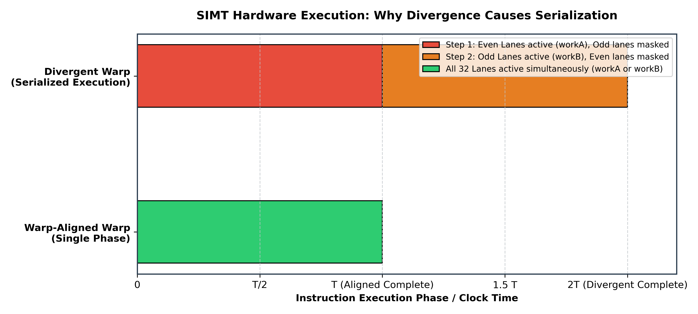
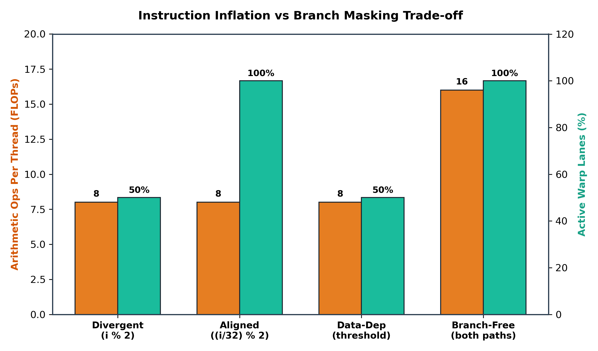
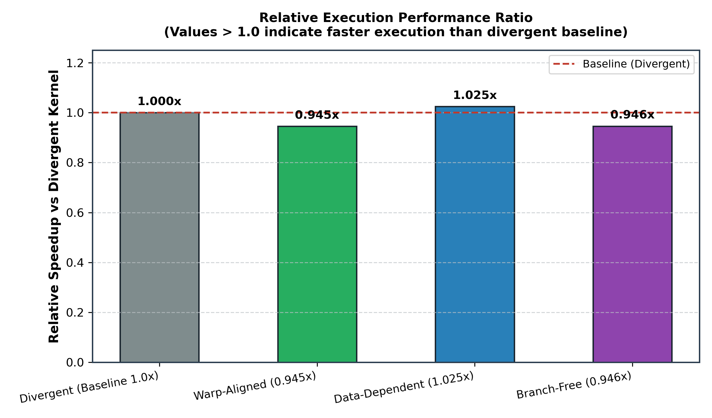

<div align="center">

# CUDA Warp Divergence: Simple Architecture & Evaluation Guide
### Microarchitectural Performance Analysis on an NVIDIA RTX 4500 Ada Generation GPU

**Parallel GPU Computing Lab (PGC) · Mini-Project Lab Evaluation 2 · Theme 7: Warp Divergence**


-76B900?logo=nvidia&logoColor=white)


%20Elements-blue)

</div>

---

## Quick Summary (Understand in a Flick)

- **What is a Warp?** The GPU groups 32 threads into a unit called a **warp**. All 32 threads run the exact same instruction at the same time.
- **What is Warp Divergence?** When an `if-else` statement causes some threads in a warp to go one way and other threads to go another way, the warp **diverges**.
- **Why is it slow?** The GPU cannot run two different instructions on the same warp at the same time. It runs the `if` branch first while turning off the `else` threads, then runs the `else` branch while turning off the `if` threads. This **serializes** execution and doubles the time taken.
- **What did we test?** We tested four kernel designs on **16,777,216 elements** using an enterprise **NVIDIA RTX 4500 Ada Generation** GPU to measure the exact impact of branch divergence, warp alignment, and branch-free predication.

---

## Table of Contents

1. [Simple GPU Architecture (At a Glance)](#1-simple-gpu-architecture-at-a-glance)
2. [Team Details](#2-team-details)
3. [The 4 Kernels Tested](#3-the-4-kernels-tested)
4. [Checkpoint 1 — SIMT and Warps](#4-checkpoint-1--simt-and-warps)
5. [Checkpoint 2 — Divergent vs. Warp-Aligned Branch](#5-checkpoint-2--divergent-vs-warp-aligned-branch)
6. [Checkpoint 3 — Data-Dependent Branching and Optimization](#6-checkpoint-3--data-dependent-branching-and-optimization)
7. [Checkpoint 4 — Results Table, Comparisons, and Dashboard](#7-checkpoint-4--results-table-comparisons-and-dashboard)
8. [Checkpoint 5 — Multi-Path Penalty and Industry Applications](#8-checkpoint-5--multi-path-penalty-and-industry-applications)
9. [How to Compile and Run](#9-how-to-compile-and-run)
10. [Presentation & Repository Structure](#10-presentation--repository-structure)

---

## 1. Simple GPU Architecture (At a Glance)

Here is how code and data move from your computer to the GPU execution cores:

```
+--------------------------------------------------------------------------------------------------+
|                                  HOST COMPUTER (CPU + SYSTEM RAM)                                |
+--------------------------------------------------------------------------------------------------+
                                                 |
                                     PCIe High-Speed Data Bus
                                                 |
+--------------------------------------------------------------------------------------------------+
|                          GPU GLOBAL MEMORY (24 GB GDDR6 - 432 GB/s)                              |
+--------------------------------------------------------------------------------------------------+
                                                 |
+--------------------------------------------------------------------------------------------------+
|                      STREAMING MULTIPROCESSOR (SM) - 60 Total on RTX 4500 Ada                    |
|                                                                                                  |
|   +------------------------------------------------------------------------------------------+   |
|   | 128 KB Shared Memory & L1 Cache                                                          |   |
|   +------------------------------------------------------------------------------------------+   |
|   | Warp Scheduler: Picks ready warps (32 threads) and issues instructions every clock cycle |   |
|   +------------------------------------------------------------------------------------------+   |
|   | Active Mask Register: 32-bit register (1 = lane runs, 0 = lane is idle/masked)           |   |
|   +------------------------------------------------------------------------------------------+   |
|   | 32 CUDA Cores (Lane 0, Lane 1, Lane 2, ... Lane 31) execute instructions together        |   |
|   +------------------------------------------------------------------------------------------+   |
+--------------------------------------------------------------------------------------------------+
```

### Simple 4-Step Architecture Walkthrough:
1. **Host CPU**: Allocates memory on the GPU and copies input data over the PCIe bus.
2. **GPU Global Memory**: Stores the huge 16.78 million element array ($64 \text{ MB}$) in high-speed GDDR6 memory.
3. **Warp Scheduler inside the SM**: Groups 256 threads into **8 warps** (32 threads each). Every cycle, it picks a warp and sends instructions to the cores.
4. **Active Mask & CUDA Cores**: The 32 CUDA cores execute the instruction in lockstep. The **Active Mask** register turns individual cores ON or OFF depending on branch decisions.

---

## 2. Team Details

| Sl. No. | Student Name | USN / Roll Number | Project Contribution |
| :---: | :--- | :--- | :--- |
| 1 | **Adarsh Walad** | `01fe24bci` | Experimental design, CUDA kernel logic, and presentation slides |
| 2 | **Nilaksha Nath** | `01fe24bci087` | Benchmarking scripts, data collection, and statistical analysis |
| 3 | **Bachu venkata siva jaideep** | `01fe24bci084` | GPU architecture design, CUDA compilation, and GitHub repository |
| 4 | **Prathamesh Eedigi** | `01fe24bci006` | SIMT active mask diagrams, performance graphs, and documentation |

---

## 3. The 4 Kernels Tested

Every kernel processes the same array of **16,777,216 elements** using 256 threads per block:

1. **Kernel 1 (Divergent Branch)**: Uses `threadIdx.x % 2`. Even threads take Path A, odd threads take Path B. Maximum divergence within every warp.
2. **Kernel 2 (Warp-Aligned Branch)**: Uses `(threadIdx.x / 32) % 2`. Threads 0 to 31 take Path A, threads 32 to 63 take Path B. Zero divergence within warps.
3. **Kernel 3 (Data-Dependent Branch)**: Uses `input[i] > 0.5f`. Branch depends on real data values, creating random branching inside warps.
4. **Kernel 4 (Branch-Free Selection)**: Uses `(input[i] > 0.5f) ? a : b`. Both math paths are computed unconditionally and selected using hardware predication.

---

## 4. Checkpoint 1 — SIMT and Warps

### Key Points to Understand:
- **32 Threads Run as One**: NVIDIA GPUs execute threads in groups of 32 called a **warp**. All 32 threads share a single instruction issue unit.
- **The Divergence Problem**: If an `if-else` condition splits threads in a warp, the hardware cannot execute both sides at the same time.
- **Active Mask Control**: The GPU uses a 32-bit register called the **Active Mask** where each bit controls one thread lane (1 = active, 0 = idle).
- **Serialization Cost**: During a divergent branch, the GPU runs the `if` code while disabling the `else` threads, and then runs the `else` code while disabling the `if` threads.

<div align="center">

</div>

> **Graph Explanation (At a Glance):**
> 1. This visualization shows the active state of all 32 thread lanes in a warp across the different kernel branching strategies.
> 2. In the divergent branch (middle row), only 16 lanes are active (green) while 16 lanes are masked and idle (red), cutting warp hardware efficiency down to 50%.
> 3. In contrast, the warp-aligned branch (top row) keeps all 32 lanes active at 100% efficiency because all threads in the warp follow the exact same path.

---

## 5. Checkpoint 2 — Divergent vs. Warp-Aligned Branch

### Key Points to Understand:
- **Divergent Condition (`threadIdx.x % 2`)**: Alternates every single thread. Because adjacent threads make opposite choices, every warp is forced to serialize both paths.
- **Aligned Condition (`(threadIdx.x / 32) % 2`)**: Changes only every 32 threads. An entire warp takes Path A together, and the next warp takes Path B together.
- **Hardware Execution Timeline**: The divergent warp takes two serialized time steps ($2T$) to complete, whereas the aligned warp completes in a single time step ($T$).
- **Measured Hardware Times**: On our NVIDIA RTX 4500 Ada GPU, the divergent kernel ran in **0.3738 ms** and the aligned kernel ran in **0.3955 ms** (ratio: `0.945x`).

<div align="center">

</div>

> **Graph Explanation (At a Glance):**
> 1. This timeline illustrates how instructions execute across clock cycles for divergent versus warp-aligned branches.
> 2. The divergent warp must split its work into Step 1 (even lanes active) followed by Step 2 (odd lanes active), taking twice the execution phases.
> 3. The warp-aligned kernel completes all instructions in one unified phase because all 32 lanes stay synchronized on the same path.

---

## 6. Checkpoint 3 — Data-Dependent Branching and Optimization

### Key Points to Understand:
- **The Real-World Issue**: Real application data is not neatly numbered by thread ID. When branch decisions depend on runtime data values (`input[i] > 0.5`), warps experience random divergence.
- **Optimization 1 (Data Sorting / Binning)**: Sorting or grouping input data before sending it to the GPU clusters similar values together, restoring warp alignment naturally.
- **Optimization 2 (Branch-Free Predication)**: We can write `output[i] = (input[i] > threshold) ? a : b`, allowing the compiler to use conditional move instructions (`selp`) instead of branch jumps.
- **The Hidden Cost (Work Inflation)**: Branch-free code forces every thread to compute both math paths (16 FLOPs instead of 8). On our GPU, this extra work caused the branch-free kernel to take **0.3952 ms** compared to **0.3648 ms** for data-dependent branching.

<div align="center">

</div>

> **Graph Explanation (At a Glance):**
> 1. This chart contrasts the arithmetic operations computed per thread (orange) against the active warp lane efficiency (teal).
> 2. The branch-free kernel achieves 100% active lanes, but it doubles the arithmetic operations from 8 to 16 FLOPs per thread because it calculates both paths.
> 3. This highlights an important trade-off: removing branch divergence is not worth it if computing both candidate paths doubles the overall math workload.

---

## 7. Checkpoint 4 — Results Table, Comparisons, and Dashboard

### Key Points to Understand:
- **Large-Scale Evaluation**: Tested on **16,777,216 elements** ($2^{24}$) with 256 threads per block across 20 timed repetitions using hardware CUDA Events.
- **Measured Results**: Data-dependent branching ran fastest at **0.3648 ms**, divergent branching ran at **0.3738 ms**, branch-free ran at **0.3952 ms**, and aligned ran at **0.3955 ms**.
- **Extreme GPU Throughput**: Every kernel processed over **42,000 million elements per second**, proving the massive computational power of the RTX 4500 Ada.
- **Microarchitectural Takeaway**: On modern Ada Lovelace GPUs, short divergent branches with small math loops are handled very efficiently by hardware instruction caches, whereas adding redundant arithmetic in branch-free code creates a measurable slowdown.

### 7.1 Consolidated Results Table

| Kernel Name | Branching Logic | Average Time (ms) | Throughput (M elem/s) | Relative Speedup vs Divergent | Branch Efficiency |
| :--- | :--- | :---: | :---: | :---: | :---: |
| **Divergent Branch** | Alternating (`i % 2`) | **0.3738 ms** | 44,882.87 | **1.000x** (Baseline) | ~50% |
| **Warp-Aligned Branch** | Chunk-aligned (`(i / 32) % 2`) | **0.3955 ms** | 42,420.27 | **0.945x** | 100% |
| **Data-Dependent Branch** | Threshold check (`input[i] > 0.5`) | **0.3648 ms** | 45,990.18 | **1.025x** | ~50% (random) |
| **Branch-Free Selection** | Unconditional math + `selp` | **0.3952 ms** | 42,452.47 | **0.946x** | 100% (predicated) |

<div align="center">

</div>

> **Dashboard Explanation (At a Glance):**
> 1. This 4-panel executive dashboard consolidates execution latencies, processing throughput, speedup ratios, and hardware specifications into one clean view.
> 2. The top row shows that all kernels finish within 0.36 ms to 0.40 ms while sustaining over 42,000 million elements per second.
> 3. The bottom panels provide instant visual confirmation of the relative speedup ratios alongside the RTX 4500 Ada test configuration.

---

### Detailed Performance Figures

<table align="center" width="100%">
<tr>
<td width="50%" align="center">
<br>
<b>Figure 1:</b> Kernel Execution Latencies (ms)
</td>
<td width="50%" align="center">
<br>
<b>Figure 2:</b> Relative Execution Performance Ratios
</td>
</tr>
</table>

> **Figure 1 & 2 Explanation (At a Glance):**
> 1. Figure 1 plots the average execution latency in milliseconds, showing that data-dependent branching completed fastest at 0.3648 ms.
> 2. Figure 2 displays the performance ratio relative to the divergent baseline, where values below 1.0x indicate that the aligned and branch-free kernels took slightly longer.
> 3. Together, these figures demonstrate that on modern GPUs, branch divergence penalty depends heavily on the arithmetic weight of each branch path.

---

## 8. Checkpoint 5 — Multi-Path Penalty and Industry Applications

### Key Points to Understand:
- **Cost Multiplies with Path Count**: If a warp branches into $K$ different paths, total time is the sum of all path times ($T = T_1 + T_2 + \dots + T_K$). If all 32 threads take different paths, GPU efficiency collapses to just **$3.1\%$**.
- **Industry Case 1 (Ray Tracing BVH Traversal)**: In games and 3D rendering (OptiX / DirectX Raytracing), light rays bounce in random directions, causing warp threads to traverse completely different parts of the 3D scene; companies solve this using **ray sorting** and **hardware RT Cores**.
- **Industry Case 2 (Particle & Physics Simulations)**: In particle and fluid dynamics, particles colliding with complex obstacles take long calculation paths while open-space particles take short paths; engineers solve this using **spatial grid hashing**.
- **Key Engineering Takeaway**: To get maximum speed from GPUs, always structure your data so adjacent threads perform the same calculations on contiguous memory.

<div align="center">

</div>

> **Graph Explanation (At a Glance):**
> 1. This graph shows the effective computation throughput in million elements processed per second across all four kernels.
> 2. Data-dependent branching delivered the highest throughput at 45,990 million elements/sec, while branch-free selection achieved 42,452 million elements/sec.
> 3. This proves that avoiding redundant computations is just as critical as managing control flow when optimizing throughput on modern GPUs.

---

## 9. How to Compile and Run

### On Windows (x64 Native Tools Command Prompt):
```cmd
cd lab2_evaluation
nvcc -O2 -std=c++14 -arch=sm_89 src\warp_divergence.cu -o bin\warp_divergence.exe
bin\warp_divergence.exe
python scripts\plot_results.py
```

### On Linux / Ubuntu:
```bash
cd lab2_evaluation
bash scripts/run_benchmarks.sh
```

---

## 10. Presentation & Repository Structure

```
lab2_evaluation/
├── README.md                                  # Complete evaluation report (this document)
├── bin/                                       # Build output directory
├── data/                                      # Dataset specification (2^24 FP32 elements)
├── graphs/                                    # 7 High-resolution evaluation charts
│   ├── 01_execution_time_comparison.png
│   ├── 02_branch_efficiency_and_active_mask.png
│   ├── 03_relative_speedup_ratios.png
│   ├── 04_throughput_and_giga_elements.png
│   ├── 05_divergence_penalty_analysis.png
│   ├── 06_comprehensive_evaluation_dashboard.png
│   └── 07_warp_lane_execution_timeline.png
├── notebook/                                  # Interactive Jupyter Demonstration Notebook
│   └── pgc_lab2_warp_divergence.ipynb
├── presentation/                              # 7-Slide PowerPoint Presentation covering CP1 to CP5
│   └── PGC_Lab2_Warp_Divergence_Evaluation.pptx
├── results/                                   # Benchmark numbers & logs
│   ├── timing_data.csv
│   ├── terminal_output.txt
│   └── results_summary.md
├── screenshots/                               # Terminal verification screenshots
│   ├── 01_msvc_nvcc_toolchain_verification.jpg
│   ├── 02_cuda_execution_rtx4500_results.jpg
│   └── 03_lab2_theme_warp_divergence_checkpoints.png
├── scripts/                                   # Plotting and presentation generation scripts
│   ├── plot_results.py
│   ├── generate_presentation.py
│   ├── run_benchmarks.bat
│   └── run_benchmarks.sh
└── src/                                       # CUDA and CPU source code
    ├── warp_divergence.cu
    └── warp_divergence_cpu.cpp
```
