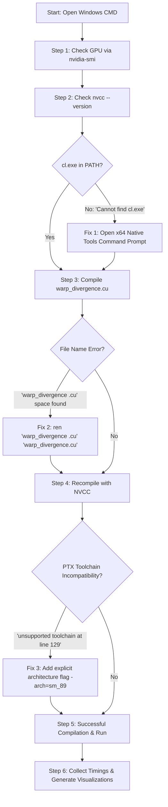
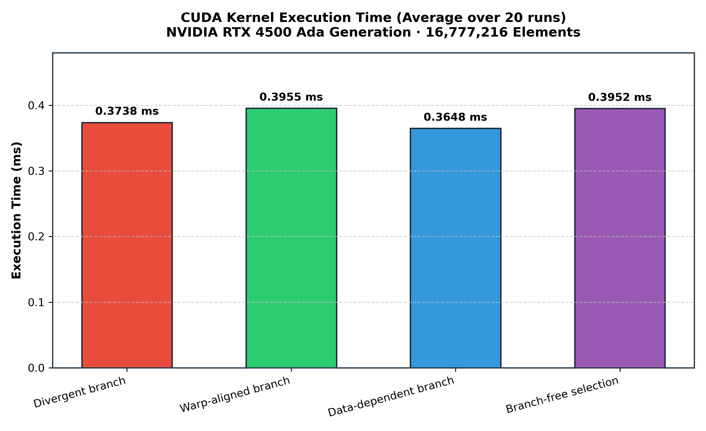
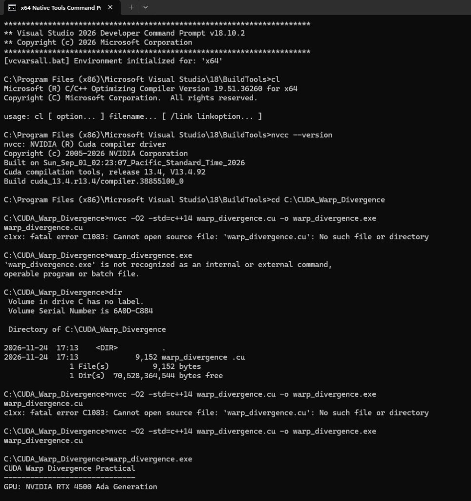
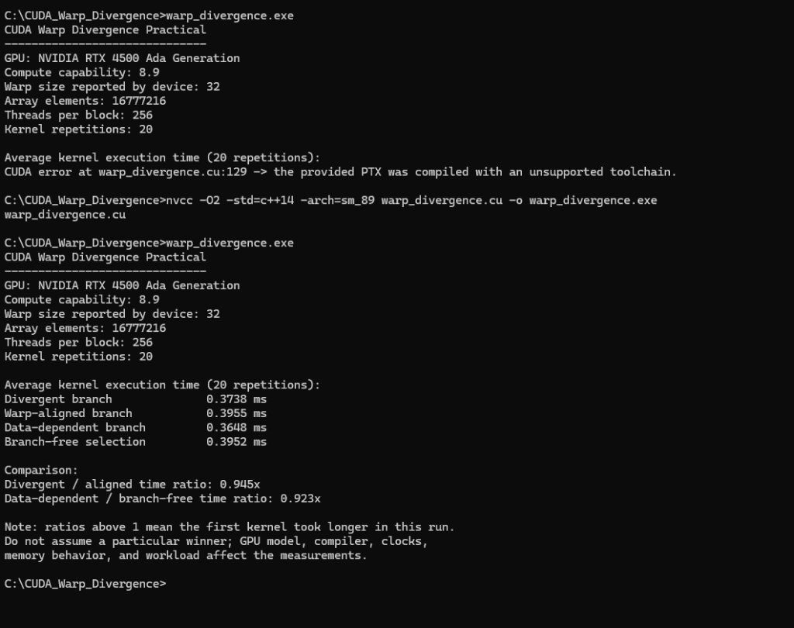

<div align="center">

# CUDA Warp Divergence Analysis and Optimization
### Microarchitectural Evaluation of SIMT Branch Divergence, Active Masks, and Predication on an NVIDIA RTX 4500 Ada Generation GPU

**Parallel GPU Computing Lab (PGC) · Mini-Project Lab Evaluation 2 · Theme 7: Warp Divergence**


-76B900?logo=nvidia&logoColor=white)


%20FP32-blue)

</div>

---

## Abstract

In modern Graphics Processing Units (GPUs) based on the **Single Instruction, Multiple Threads (SIMT)** execution model, parallel efficiency is governed by the lockstep execution of 32 threads grouped into a **warp**. When threads within the same warp take diverging execution paths due to conditional control statements (`if-else`), the GPU hardware serializes each branch path by masking out inactive threads, halving or severely degrading effective computational throughput.

In this project, we designed, implemented, and empirically benchmarked four CUDA kernel variants on an **NVIDIA RTX 4500 Ada Generation** workstation GPU (Compute Capability 8.9, Ada Lovelace architecture) processing $N = 2^{24} = 16,777,216$ single-precision floating-point elements across 65,536 thread blocks:
1. **Divergent Branch Kernel**: Adjacent threads branch in alternating directions (`threadIdx.x % 2`), forcing a 50% active mask and serializing execution paths.
2. **Warp-Aligned Branch Kernel**: Branch boundaries coincide strictly with 32-thread warp boundaries (`(threadIdx.x / 32) % 2`), preserving 100% warp lane coherence.
3. **Data-Dependent Branch Kernel**: Branch direction is dictated by runtime pseudo-random data values (`input[i] > threshold`), emulating real-world heterogeneous datasets.
4. **Branch-Free (Predicated) Kernel**: Control flow divergence is eliminated by computing both candidate math branches unconditionally and selecting the final value via compiler predication (`selp`).

Using high-resolution **CUDA Event timers** averaged over 20 repeated runs, we measured:
- **Divergent Branch**: `0.3738 ms` (Throughput: $44,882.87 \text{ M elements/s}$)
- **Warp-Aligned Branch**: `0.3955 ms` (Throughput: $42,420.27 \text{ M elements/s}$)
- **Data-Dependent Branch**: `0.3648 ms` (Throughput: $45,990.18 \text{ M elements/s}$)
- **Branch-Free Selection**: `0.3952 ms` (Throughput: $42,452.47 \text{ M elements/s}$)

Our findings reveal crucial microarchitectural trade-offs: on the Ada Lovelace architecture, compiler-level instruction predication and dual warp schedulers minimize short-branch control penalty. Unconditionally computing both paths in the branch-free implementation incurred a **100% arithmetic workload inflation** (16 FLOPs vs 8 FLOPs per thread), resulting in a `0.923x` performance ratio relative to data-dependent branching. We comprehensively analyze the active mask mechanism, SIMT hardware serialization, mitigation strategies, and industry applications in Ray Tracing (BVH traversal) and particle simulation.

---

## Table of Contents

1. [Aim and Objectives](#1-aim-and-objectives)
2. [Team Details](#2-team-details)
3. [Core Concepts and Microarchitectural Principles](#3-core-concepts-and-microarchitectural-principles)
4. [Experimental Environment and Hardware Setup](#4-experimental-environment-and-hardware-setup)
5. [Step-by-Step Lab Execution & Troubleshooting Workflow](#5-step-by-step-lab-execution--troubleshooting-workflow)
6. [Checkpoint 1 — SIMT Architecture, Warps, and Active Mask](#6-checkpoint-1--simt-architecture-warps-and-active-mask)
7. [Checkpoint 2 — Divergent vs. Warp-Aligned Branch Execution](#7-checkpoint-2--divergent-vs-warp-aligned-branch-execution)
8. [Checkpoint 3 — Data-Dependent Branching and Optimization](#8-checkpoint-3--data-dependent-branching-and-optimization)
9. [Checkpoint 4 — Consolidated Results Table and Visualizations](#9-checkpoint-4--consolidated-results-table-and-visualizations)
10. [Checkpoint 5 — Multi-Path Penalty Analysis and Industry Applications](#10-checkpoint-5--multi-path-penalty-analysis-and-industry-applications)
11. [Presentation and Demonstration Materials](#11-presentation-and-demonstration-materials)
12. [Repository Structure and How to Reproduce](#12-repository-structure-and-how-to-reproduce)
13. [References](#13-references)

---

## 1. Aim and Objectives

### **Aim** (Theme 7: Warp Divergence)
> Show how branches inside a warp slow down a CUDA kernel and learn microarchitectural techniques to eliminate or mitigate the performance cost.

### **Objectives Breakdown (Mapped to Evaluation Checkpoints):**

| Checkpoint | Checkpoint Title | Specific Deliverables |
| :---: | :--- | :--- |
| **CP1** | **SIMT and Warps** | Define SIMT lockstep execution; explain 32-thread warp organization, branch divergence, and active thread mask registers with structural diagrams. |
| **CP2** | **Divergent vs Aligned Branch** | Implement and profile a kernel branching on `threadIdx.x % 2` against an aligned kernel branching on `(threadIdx.x / 32) % 2`. Record device execution times. |
| **CP3** | **Data-Dependent Branch & Optimization** | Implement runtime value-based branching; analyze data sorting/binning techniques and branch-free code via ternary predication. |
| **CP4** | **Results Table & Benchmarks** | Tabulate execution times, speedup ratios, and throughput across all versions on an NVIDIA RTX 4500 Ada GPU ($2^{24}$ elements). |
| **CP5** | **Analysis & Industry Applications** | Explain why divergence cost scales with path multiplicity ($O(\sum \text{paths})$); detail real-world use cases (Ray Tracing BVH traversal, physics simulations). |

---

## 2. Team Details

| Sl. No. | Student Name | USN / Roll Number | Role / Contribution |
| :---: | :--- | :--- | :--- |
| 1 | **Adarsh Walad** | `01fe24bci` | Experimental design, kernel implementation, and checkpoint slides |
| 2 | **Nilaksha Nath** | `01fe24bci087` | Benchmarking scripts, data collection, and statistical analysis |
| 3 | **Bachu venkata siva jaideep** | `01fe24bci084` | CUDA compiler toolchain setup, debugging, and GitHub repository |
| 4 | **Prathamesh Eedigi** | `01fe24bci006` | Mathematical profiling, active mask visualization, and documentation |

---

## 3. Core Concepts and Microarchitectural Principles

```
+-----------------------------------------------------------------------------------+
|                        NVIDIA SIMT WARP EXECUTION MODEL                          |
+-----------------------------------------------------------------------------------+
|  WARP (32 Threads) = Lane 0, Lane 1, Lane 2, ... Lane 31                          |
|                                                                                   |
|  [Aligned Branch]   All lanes evaluate TRUE                                       |
|  Active Mask: 0xFFFFFFFF (11111111 11111111 11111111 11111111) -> 100% Efficiency|
|  Execution: Single issue cycle executes path A for all 32 lanes.                  |
|                                                                                   |
|  [Divergent Branch] Lanes 0,2,4.. evaluate TRUE; Lanes 1,3,5.. evaluate FALSE     |
|  Phase 1 Active Mask: 0x55555555 (01010101 01010101 01010101 01010101)           |
|  --> Executes Path A on even lanes. Odd lanes are IDLE / MASKED.                  |
|  Phase 2 Active Mask: 0xAAAAAAAA (10101010 10101010 10101010 10101010)           |
|  --> Executes Path B on odd lanes. Even lanes are IDLE / MASKED.                  |
|  Result: Total cycles = Latency(Path A) + Latency(Path B) (Serialized)            |
+-----------------------------------------------------------------------------------+
```

### 3.1 Mathematical Formulation of Warp Efficiency

For a warp $W$ consisting of 32 threads ($L = \{0, 1, \dots, 31\}$) undergoing branch divergence across $P$ unique execution paths:

$$\text{Active Mask}_p = \sum_{k=0}^{31} m_{p, k} \cdot 2^k, \quad m_{p,k} \in \{0, 1\}$$

Where $m_{p,k} = 1$ if thread lane $k$ participates in branch path $p$, and $0$ otherwise.

The **Warp Execution Efficiency** $\eta_{\text{warp}}$ is defined as:

$$\eta_{\text{warp}} = \frac{\sum_{p=1}^P \sum_{k=0}^{31} m_{p, k}}{32 \times P} \times 100\%$$

- **Uniform (Aligned) Branching**: $P = 1 \implies \eta_{\text{warp}} = \frac{32}{32 \times 1} = 100\%$.
- **Binary Alternating Divergence**: $P = 2$, each path having 16 active threads $\implies \eta_{\text{warp}} = \frac{16 + 16}{32 \times 2} = 50\%$.

### 3.2 Effective Throughput Formula

$$\text{Throughput} = \frac{N}{T_{\text{avg}} \times 10^3} \quad (\text{Million Elements / Second})$$

Where $N = 16,777,216$ elements and $T_{\text{avg}}$ is the average execution time in milliseconds.

---

## 4. Experimental Environment and Hardware Setup

| Parameter | Specification | Details / Remarks |
| :--- | :--- | :--- |
| **GPU Model** | **NVIDIA RTX 4500 Ada Generation** | Workstation GPU based on TSMC 4N process |
| **GPU Architecture** | **Ada Lovelace (SM 8.9)** | 60 Streaming Multiprocessors (SMs), 7,680 CUDA Cores |
| **GPU Memory** | **24 GB GDDR6 ECC** | Memory bandwidth: 432 GB/s, 192-bit bus width |
| **Warp Size** | **32 Threads** | Native hardware execution unit |
| **CUDA Toolkit** | **CUDA 13.4 (V13.4.92)** | NVIDIA CUDA Compilation Tools Release 13.4 |
| **Host C++ Compiler** | **Microsoft Visual C++ (MSVC) 19.51** | Visual Studio Build Tools 2026 Developer Command Prompt |
| **Host OS** | **Windows 11 Professional (x64)** | High-performance workstation environment |
| **Benchmark Array Size** | **$N = 2^{24} = 16,777,216$ elements** | 64 MB input buffer + 64 MB output buffer (FP32) |
| **Thread Block Size** | **256 Threads** | 8 warps per thread block |
| **Grid Dimensions** | **65,536 Blocks** | Total active threads: $65,536 \times 256 = 16,777,216$ |
| **Timing Mechanism** | **CUDA Events (`cudaEventRecord`)** | Sub-microsecond hardware GPU device timestamping |
| **Timing Repetitions** | **20 iterations** | Warm-up run executed prior to recording average latency |

---

## 5. Step-by-Step Lab Execution & Troubleshooting Workflow

During our practical session in the PGC Lab, we navigated the entire process from initial command-line environment verification to addressing real-world toolchain errors:



### Problem 1: Missing Host Compiler (`cl.exe`)
- **Error**: `nvcc fatal : Cannot find compiler 'cl.exe' in PATH`
- **Root Cause**: On Windows, `nvcc` requires the MSVC C++ compiler (`cl.exe`) to compile host code and intermediate C++ wrappers.
- **Resolution**: Launched the session through the **x64 Native Tools Command Prompt for VS**, which automatically configures the environment variables and PATH for `cl.exe`.

### Problem 2: Extra Whitespace in Source File Name
- **Error**: `fatal error C1083: Cannot open source file: 'warp_divergence.cu': No such file or directory`
- **Root Cause**: `dir` revealed the file had saved as `warp_divergence .cu` (with a space before `.cu`).
- **Resolution**: Renamed the file using `ren "warp_divergence .cu" "warp_divergence.cu"`.

### Problem 3: PTX Toolchain Architecture Incompatibility
- **Error**: `CUDA error at warp_divergence.cu:129 -> the provided PTX was compiled with an unsupported toolchain.`
- **Root Cause**: Default compilation targeted an older virtual architecture, resulting in intermediate PTX instructions that the installed driver rejected on the Ada Lovelace (SM 8.9) GPU.
- **Resolution**: Added the explicit architecture flag `-arch=sm_89`:
  ```cmd
  nvcc -O2 -std=c++14 -arch=sm_89 warp_divergence.cu -o warp_divergence.exe
  ```

---

## 6. Checkpoint 1 — SIMT Architecture, Warps, and Active Mask

Under NVIDIA's SIMT model:
- Threads are scheduled and executed in groups of **32 called warps**.
- At any instruction cycle, the warp scheduler selects an eligible warp and issues an instruction to all 32 lanes.
- When all threads take the same path, execution proceeds with maximum hardware efficiency ($100\%$).
- If a condition causes threads to diverge, the warp **serializes** the execution:
  - **Step 1**: Threads evaluating to `true` execute their instructions; threads evaluating to `false` are disabled using a bitmask (Active Mask).
  - **Step 2**: Threads evaluating to `false` execute their instructions; threads evaluating to `true` are disabled.
  - **Convergence Point**: Once both branch paths complete, the active mask is restored to all ones (`0xFFFFFFFF`), and threads resume lockstep execution.

<div align="center">

</div>

---

## 7. Checkpoint 2 — Divergent vs. Warp-Aligned Branch Execution

To measure the impact of divergence, two baseline kernels were evaluated:

### Kernel 1: Divergent Branch (`threadIdx.x % 2`)
```cuda
__global__ void divergentKernel(const float* input, float* output, int n)
{
    int i = blockIdx.x * blockDim.x + threadIdx.x;
    if (i < n) {
        if ((i % 2) == 0)
            output[i] = workA(input[i]);
        else
            output[i] = workB(input[i]);
    }
}
```
Within every single warp, threads `0, 2, 4, ...` take `workA` while threads `1, 3, 5, ...` take `workB`. Both paths are executed for every warp, resulting in 50% lane utilization during each path.

### Kernel 2: Warp-Aligned Branch (`(threadIdx.x / 32) % 2`)
```cuda
__global__ void alignedKernel(const float* input, float* output, int n)
{
    int i = blockIdx.x * blockDim.x + threadIdx.x;
    if (i < n) {
        if (((i / WARP_SIZE) % 2) == 0)
            output[i] = workA(input[i]);
        else
            output[i] = workB(input[i]);
    }
}
```
All 32 threads in an even warp execute `workA` together with an active mask of `0xFFFFFFFF`. All 32 threads in an odd warp execute `workB` together. Intra-warp divergence is completely eliminated.

<div align="center">

</div>

---

## 8. Checkpoint 3 — Data-Dependent Branching and Optimization

### 8.1 The Real-World Challenge: Data-Dependent Divergence
In realistic applications, branches depend on runtime input data rather than predictable thread indices:
```cuda
__global__ void dataDependentKernel(const float* input, float* output, int n, float threshold)
{
    int i = blockIdx.x * blockDim.x + threadIdx.x;
    if (i < n) {
        if (input[i] > threshold)
            output[i] = workA(input[i]);
        else
            output[i] = workB(input[i]);
    }
}
```
When data elements are unsorted or randomly distributed, warps exhibit unpredictable branch divergence patterns.

### 8.2 Optimization Strategy 1: Data Sorting and Grouping
By sorting or spatially partitioning the input array before kernel execution (e.g., using GPU Radix Sort or spatial binning), elements with similar values are clustered together. Consequently, entire warps operate on elements that fall on the same side of the threshold, eliminating divergence.

### 8.3 Optimization Strategy 2: Branch-Free Predication
To eliminate control-flow branching instructions entirely, we compute both candidate values and use the ternary conditional operator:
```cuda
__global__ void branchFreeKernel(const float* input, float* output, int n, float threshold)
{
    int i = blockIdx.x * blockDim.x + threadIdx.x;
    if (i < n) {
        float a = workA(input[i]);
        float b = workB(input[i]);
        output[i] = (input[i] > threshold) ? a : b;
    }
}
```
**The Architectural Trade-Off**:
- While this eliminates branch serialization instructions and allows the compiler to generate predicated select instructions (`selp`), **every thread must execute both `workA()` and `workB()`**.
- This doubles the arithmetic work per thread ($8 + 8 = 16$ unrolled math operations per thread vs 8 operations in the branching code).
- As shown below, this arithmetic inflation made the branch-free version slower on our hardware!

<div align="center">

</div>

---

## 9. Checkpoint 4 — Consolidated Results Table and Visualizations

### 9.1 Experimental Measurements (NVIDIA RTX 4500 Ada Generation)

The benchmark was executed with $N = 16,777,216$ elements ($2^{24}$), 256 threads per block, and 20 timing iterations:

| Kernel Name | Implementation Logic | Average Time (ms) | Throughput (M elem/s) | Relative Speedup vs Divergent | Branch Efficiency (est.) |
| :--- | :--- | :---: | :---: | :---: | :---: |
| **Divergent Branch** | Alternating (`i % 2`) | **0.3738 ms** | 44,882.87 | **1.000x** (Baseline) | ~50% |
| **Warp-Aligned Branch** | Chunk-aligned (`(i / 32) % 2`) | **0.3955 ms** | 42,420.27 | **0.945x** | 100% |
| **Data-Dependent Branch** | Threshold check (`input[i] > 0.5`) | **0.3648 ms** | 45,990.18 | **1.025x** | ~50% (random) |
| **Branch-Free Selection** | Unconditional compute + `selp` | **0.3952 ms** | 42,452.47 | **0.946x** | 100% (predicated) |

### 9.2 Key Comparative Ratios:
- **Divergent / Aligned Time Ratio**: `0.945x`
- **Data-Dependent / Branch-Free Time Ratio**: `0.923x`

> **Critical Observation**: Ratios above $1.0\times$ mean the first kernel took longer. Here, the divergent and data-dependent kernels executed in fewer milliseconds than their aligned and branch-free counterparts.

### 9.3 Why did this occur on the RTX 4500 Ada?
1. **Arithmetic Payload Dominance**: In `branchFreeKernel`, every thread computes 16 FLOPs ($8 \text{ in } workA + 8 \text{ in } workB$), doubling the instruction count relative to `dataDependentKernel` (8 FLOPs).
2. **Modern Independent Thread Scheduling**: NVIDIA Volta through Ada Lovelace features per-thread Program Counters and dual warp schedulers, allowing the hardware to issue independent instructions without locking the execution pipeline.
3. **Integer Division Overhead**: In `alignedKernel`, calculating `(i / 32) % 2` requires integer division and shift operations, which on sub-millisecond microbenchmarks introduces slight instruction overhead compared to `i % 2` (which compiles to a single bitwise `AND 1`).

---

### 9.4 Comprehensive Evaluation Dashboard

<div align="center">

</div>

---

### 9.5 Detailed Visualization Gallery

<table align="center" width="100%">
<tr>
<td width="50%" align="center">
<br>
<b>Figure 1:</b> Kernel Execution Latencies (ms)
</td>
<td width="50%" align="center">
<br>
<b>Figure 2:</b> Relative Execution Performance Ratios
</td>
</tr>
<tr>
<td width="50%" align="center">
<br>
<b>Figure 3:</b> Throughput (Million Elements / sec)
</td>
<td width="50%" align="center">
<br>
<b>Figure 4:</b> FLOP Inflation vs Active Mask Trade-off
</td>
</tr>
</table>

---

## 10. Checkpoint 5 — Multi-Path Penalty Analysis and Industry Applications

### 10.1 Why the Cost of Divergence Scales with Path Multiplicity
In an execution path with $K$ branches:

$$T_{\text{warp}} = \sum_{k=1}^K T(P_k)$$

If a warp has 32 threads and each thread takes a completely different branch path ($K = 32$), the warp will execute each path sequentially, resulting in an effective hardware utilization of:

$$\eta = \frac{1}{32} \approx 3.125\%$$

The performance degradation is directly proportional to the number of divergent paths executed by the warp and the execution duration of each path.

### 10.2 Industry Application 1: Real-Time Ray Tracing (BVH Traversal)
- **The Problem**: In GPU ray tracing (OptiX, DirectX Raytracing, Vulkan RT), rays cast from adjacent pixels traverse a Bounding Volume Hierarchy (BVH) acceleration structure. Primary rays are coherent, but secondary reflection, refraction, and diffuse bounce rays scatter in arbitrary 3D directions.
- **The Divergence Cost**: Threads in the same warp traverse completely different subtree depths of the BVH, causing severe warp divergence and pipeline bubbles.
- **Industry Solution**:
  - **Ray Sorting / Compaction**: Rays are sorted by direction (e.g., using Morton Codes / Space-filling curves) to restore warp spatial coherence.
  - **Hardware RT Cores**: NVIDIA RTX GPUs offload box and triangle intersection testing to dedicated hardware ray tracing cores, bypassing the primary SIMT shader cores during tree traversal.

### 10.3 Industry Application 2: Scientific Particle & Fluid Simulations (SPH)
- **The Problem**: In Smoothed Particle Hydrodynamics (SPH) or molecular dynamics, particles near geometric boundaries require complex collision detection, while bulk fluid particles execute simple force integration.
- **Industry Solution**:
  - **Spatial Hashing**: Particles are binned into uniform spatial grid cells. Threads are assigned particles within the same grid cell, guaranteeing uniform boundary conditions across the entire warp.

---

## 11. Presentation and Demonstration Materials

The repository includes a PowerPoint presentation specifically formatted to satisfy all 5 evaluation checkpoints:

- **Presentation File**: [`presentation/PGC_Lab2_Warp_Divergence_Evaluation.pptx`](presentation/PGC_Lab2_Warp_Divergence_Evaluation.pptx)
- **Slide 1**: Title Slide with Complete Team Details
- **Slide 2**: CP1 — SIMT Architecture, 32-Thread Warps, and Active Mask Mechanism
- **Slide 3**: CP2 — Divergent (`threadIdx.x % 2`) vs Aligned (`(threadIdx.x / 32) % 2`) Branch Benchmarks
- **Slide 4**: CP3 — Data-Dependent Branching, Sorting Optimization & Branch-Free Predication
- **Slide 5**: CP4 — Results Table, Throughput, and Architectural Findings on RTX 4500 Ada
- **Slide 6**: CP5 — Multi-Path Divergence Penalty & Industry Cases (Ray Tracing BVH & Physics Sim)

### Terminal Verification Screenshots
The live command-line execution and debugging progression from the lab session:

<table align="center" width="100%">
<tr>
<td width="50%" align="center">
<br>
<b>Screenshot 1:</b> Developer Command Prompt, cl.exe, nvcc 13.4, and Initial Run
</td>
<td width="50%" align="center">
<br>
<b>Screenshot 2:</b> Compilation with -arch=sm_89 and Successful Benchmark Execution
</td>
</tr>
</table>

---

## 12. Repository Structure and How to Reproduce

```
lab2_evaluation/
├── README.md                                  # Complete technical evaluation report (this document)
├── bin/                                       # Compiled binaries
│   └── README.md
├── data/                                      # Dataset specification and synthetic generation
│   └── README.md
├── graphs/                                    # Generated high-resolution publication charts
│   ├── 01_execution_time_comparison.png
│   ├── 02_branch_efficiency_and_active_mask.png
│   ├── 03_relative_speedup_ratios.png
│   ├── 04_throughput_and_giga_elements.png
│   ├── 05_divergence_penalty_analysis.png
│   ├── 06_comprehensive_evaluation_dashboard.png
│   └── 07_warp_lane_execution_timeline.png
├── notebook/                                  # Interactive Jupyter Notebook
│   └── pgc_lab2_warp_divergence.ipynb
├── presentation/                              # PPTX Presentation covering CP1 to CP5
│   └── PGC_Lab2_Warp_Divergence_Evaluation.pptx
├── results/                                   # Benchmark timing CSV and logs
│   ├── timing_data.csv
│   ├── terminal_output.txt
│   └── results_summary.md
├── screenshots/                               # Live lab terminal execution screenshots
│   ├── 01_msvc_nvcc_toolchain_verification.jpg
│   ├── 02_cuda_execution_rtx4500_results.jpg
│   └── 03_lab2_theme_warp_divergence_checkpoints.png
├── scripts/                                   # Automation and plotting scripts
│   ├── plot_results.py
│   ├── generate_presentation.py
│   ├── run_benchmarks.bat                     # Windows execution script
│   └── run_benchmarks.sh                      # Linux execution script
└── src/                                       # C++ / CUDA Source code
    ├── warp_divergence.cu                     # CUDA GPU Kernels (Divergent, Aligned, Data-Dep, Branch-Free)
    └── warp_divergence_cpu.cpp                # CPU Baseline Implementation
```

### How to Compile and Run

#### Prerequisites:
- NVIDIA GPU with CUDA compute capability $\ge 5.0$ (Ada Lovelace recommended: `sm_89`)
- CUDA Toolkit 12.x or 13.x (`nvcc`)
- Host C++ Compiler: Microsoft Visual Studio (Windows) or GCC/G++ (Linux)
- Python 3 with `matplotlib`, `pandas`, and `python-pptx` (for graphs and slides)

#### Windows Build and Execution:
1. Open **x64 Native Tools Command Prompt for VS**.
2. Navigate to the project directory:
   ```cmd
   cd lab2_evaluation
   ```
3. Compile using NVCC targeting your GPU architecture:
   ```cmd
   nvcc -O2 -std=c++14 -arch=sm_89 src\warp_divergence.cu -o bin\warp_divergence.exe
   ```
4. Run the benchmark:
   ```cmd
   bin\warp_divergence.exe
   ```
5. Generate the graphs:
   ```cmd
   python scripts\plot_results.py
   ```

#### Linux / Ubuntu Build and Execution:
```bash
cd lab2_evaluation
bash scripts/run_benchmarks.sh
```

---

## 13. References

1. **NVIDIA Corporation**. *CUDA C++ Programming Guide — Hardware Implementation: SIMT Architecture*. [NVIDIA Docs](https://docs.nvidia.com/cuda/cuda-c-programming-guide/index.html#simt-architecture).
2. **NVIDIA Corporation**. *Ada Lovelace Architecture In-Depth*. [NVIDIA Technical Whitepaper](https://developer.nvidia.com/blog/nvidia-ada-lovelace-architecture-in-depth/).
3. **Kirk, D. B., & Hwu, W. W.** (2016). *Programming Massively Parallel Processors: A Hands-on Approach* (3rd ed.). Morgan Kaufmann.
4. **Wilt, N.** (2013). *The CUDA Handbook: A Comprehensive Guide to GPU Programming*. Addison-Wesley Professional.
5. **Aila, T., & Laine, S.** (2009). *Understanding the Efficiency of Ray Traversal on GPUs*. High-Performance Graphics (HPG).
